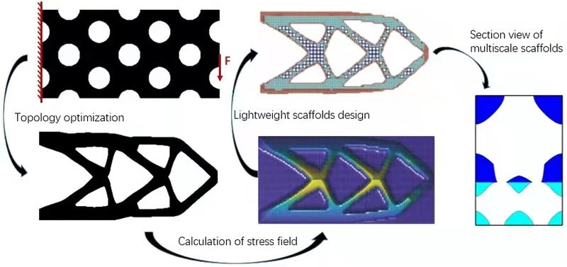

# 体验规范与 Simulation 展示方案 v1 · Qing Xia / 夏青 学术个人主页

> 交付阶段：Phase 2（体验设计 / UX）
> 适用仓库：`Riedel12315/qingxia.github.io` · 线上 `https://qingxiaxjtu.com`
> 本地副本：`C:/Users/Qing Xia/WorkBuddy/Homepage`
> 上游输入：`.design/01-visual-direction.md`（Phase 1，既定输入，本文件不推翻其视觉数值，仅在体验层标注冲突）
> 已逐文件核对：`_pages/simulating_fig.md`、`_pages/about.md`、`_pages/cv.md`、`_pages/publications.md`、`_pages/instants.md`、`_data/navigation.yml`、`_config.yml`、`_includes/author-profile.html`、`_includes/masthead.html`、`_includes/head/custom.html`、`assets/js/simulation-spiral.js`、`assets/js/abstract-modal.js`、`assets/js/lineage-tree.js`、`images/simulation/`（16 个文件逐一统计字节）。
> 本文件只定义**信息结构 / 交互状态 / DOM 与数据契约 / 响应式 / 无障碍 / 性能 / 验收**，不含最终业务代码，不修改任何业务文件。
> 下游：本文是 Phase 3 前端落地的实现规格，所有条目须可在**无 Ruby/Jekyll 的纯静态 HTML 预览页**上验证。

---

## 0. 硬约束、代码事实核对与对上游诊断的修正

### 0.1 硬约束

| 项 | 约束 | 对体验设计的直接约束 |
|---|---|---|
| 架构 | 保留 Jekyll 骨架，`_pages/` `_publications/` 与 GitHub Pages 部署不变；**不引入前端框架 / 构建工具 / 打包器** | 交互只能用原生 HTML/Liquid/CSS/ES5-ES2017 JS；容器查询、`<details>`、IntersectionObserver 等浏览器原生能力可用；不得引入 React/Vue/jQuery 插件/GIF 解码库 |
| 导航 | **不改导航结构与 permalink** | 5 项导航与 `/cv/ /publications/ /simulation/ /teaching/ /instants/` 全部保留；只能在标记层补 `aria-current`、层级与折叠 |
| 内容 | 内容不丢失、不重写 | 首页 5 区块、13 个子项、16 张图、10 个 PDF 全部保留；只做层级降级、折叠、重排（重排需主理人确认） |
| 皮肤 | 单一浅色（Phase 1） | 全站不再有 `.light-mode` / `prefers-color-scheme` / 主题切换；交互状态不得依赖深色底 |
| 动效 | 首屏零持续动画，仅用户触发 120–160ms 颜色/边框/透明度过渡 | 禁止持续自转、自动轮播、3D 透视、入场位移、弹跳；GIF 默认零自动播放 |
| 验证 | Phase 3 会做不依赖构建的静态预览页 | 运行时契约必须落在 **DOM 的 `data-*` 与静态 HTML** 上，JS 不得依赖 Liquid 产物之外的外部数据文件 |

### 0.2 代码事实（逐行/逐字节核对结果）

| 事实 | 数值 | 依据 |
|---|---|---|
| Simulation 一级分组（H1） | **3** | `# CAD for 3D printing` / `# Computational fluids flow(CFD)` / `# Image processing` |
| Simulation 子项（H2） | **13** | 分组分布 6 / 5 / 2 |
| `` 标签数 | **16** | 分组分布 8 / 6 / 2 |
| 文件类型 | 9 GIF + 3 JPG + 4 PNG = 16 | `images/simulation/` 目录 |
| 目录总字节 | **26,848,641 B ≈ 25.6 MiB（约 26.8 MB）** | `ls -la` 逐文件累加 |
| 其中 9 个 GIF | **20,996,712 B ≈ 20.0 MiB（约 21.0 MB）** | 单个最大 `INqhYJLjSXtRsdy.gif` 4,987,315 B |
| 其中 7 张静图 | **5,851,929 B ≈ 5.6 MiB** | `cVWNwOCZLH46XUG.png` 单张 **4,032,132 B**（静图里最大，首屏风险点） |
| H2 内 `[(PDF)](...)` 链接 | **10** | 分组分布 4 / 4 / 2 |
| 无 PDF 子项 | **3**（不是 2） | `2D simulations of SLM`、`Transition of different crystalline and quasicrystalline states`、`CFD based on SPH method` |
| 多图子项 | **2** | `Digital twin with FDM` 3 张；`CFD on surfaces` 2 张（原文 `640px` + `240px` **不等宽并排**） |
| 图片宽度写法 | 15 处 `width="900px"`，2 处 `640px/240px` | 全为**显示宽度**而非固有尺寸，无 `height`、无 `alt`、无 `loading` |
| 首页区块 | 引言段 + 4 个 **Setext H1**（`======`） | `Research(研究)` / `News（新闻）` / `Magnum Opus（代表作）` / `Awards（获奖）`，行 14/18/60/78 |
| 首页新闻条目 | **39** 条 | 2025:8 / 2024:16 / 2023:12 / 2022:3 |
| 首页代表作 / 获奖 | 15 条 / 10 条 | — |
| 侧栏有效链接 | 5 条 | location / Google Scholar / Email / ResearchGate / ORCID（`_config.yml` author 段实际非空字段） |
| 导航可见项 | 站点名 + 5 项 = 6 | `_includes/masthead.html` greedy-nav + `.hidden-links` |

### 0.3 对上游诊断的 3 处修正（Phase 3 以本节为准）

| # | 上游表述 | 核实结果 | 影响 |
|---|---|---|---|
| 1 | 「约 16 个 H2 子项、约 20 张 ``」 | **13 个 H2、16 张图** | 数据契约与验收计数必须用 3 / 13 / 16；若按 16 子项建模会凭空多出 3 个空条目 |
| 2 | 「9 个 GIF 约 26MB」 | 9 GIF 约 **21.0 MB**；26 MB 是**整个目录**（含 7 张静图约 5.6 MB） | 性能预算需同时覆盖 GIF 与静图；`cVWNwOCZLH46XUG.png` 4 MB 静图必须生成 poster，否则「只给 GIF 做静帧」的优化不成立 |
| 3 | 「无 PDF 子项如 2D SLM、Transition…」（举例 2 个） | 实际 **3 个**（另有 `CFD based on SPH method`） | 无 PDF 的渲染分支必须覆盖 3 条，验收项按 3 条计数 |

### 0.4 额外发现的 3 个信息架构缺陷（Phase 1 未覆盖）

| # | 缺陷 | 代码依据 | 危害 | 处置（见 §1 / §8） |
|---|---|---|---|---|
| A | **`/resume` 重定向冲突：3 个页面同时声明** | `cv.md:7`、`instants.md:7`、`simulating_fig.md:7` 均为 `- /resume` | `jekyll-redirect-from` 会为同一路径生成多个 `resume/index.html`，构建覆盖不确定；用户访问 `/resume` 可能落到 Instants 或 Simulation | 保留 `cv.md` 的 `/resume`（语义属 Biography），删除 `instants.md` 与 `simulating_fig.md` 的两处；**不改任何 permalink**，只动 `redirect_from` |
| B | **首页多 H1：单页 5 个 `<h1>`** | 布局 `single` 渲染 `page.title` 为 `<h1 class="page__title">`，`about.md` 另有 4 个 Setext `======` H1 | 文档大纲破碎，读屏用户无法用标题导航；与 Phase 1「靠字重分级建立层级」直接冲突 | 4 个 Setext H1 降为 `##`（内容逐字保留），形成 `h1 → h2 → h3` 单一大纲 |
| C | **首页 `/`（About me）没有导航入口** | `_data/navigation.yml` 首项是 `Biography → /cv/`；首页仅由站点名「Qing Xia / 夏青」链接到 `/` | 「Biography」易被误解为首页，首页只能通过站点名返回；`aria-current` 在首页无对应项 | 不改导航结构的前提下：站点名链接补 `aria-label="Qing Xia / 夏青 — 返回首页"`，并规定**首页时所有 5 项均不加 `aria-current`**（站点名以 `font-weight:700` + `--c-ink` 承担当前态），在 `/cv/` 等页给对应项加 `aria-current="page"` |

---

## 1. 信息架构与导航

### 1.1 现有导航与首页区块的冗余 / 优先级评估

约束：不改 `_data/navigation.yml` 的 5 项与 permalink。因此**只能改首页内部的层级、顺序、折叠与跨页链接**，不能新增/删减导航项。

| 导航项 | URL | 与首页内容的关系 | 优先级判断 |
|---|---|---|---|
| Biography（简介） | `/cv/` | 含 CV 链接、Education、学术传承、Research interest、Teaching Assistant、Contact | 结构页，保留。与首页 `Research(研究)` 存在「研究兴趣」重复（首页为叙述+量化指标，CV 为 3 条关键词列表）→ 首页保留叙述与指标，关键词列表只在 CV |
| Publications（论文） | `/publications/` | 43 篇完整列表 + 摘要 JSON + 专利 | 全量真源。首页 `Magnum Opus` 15 条是它的子集（**重复**） |
| Simulation（模拟） | `/simulation/` | 3 组 13 项 16 图 | 本次重构主体 |
| Teaching（教学） | `/teaching/` | 与 `/cv/` 的 `Teaching Assistant` 两条重复 | 保留导航；CV 中两条助教经历不再展开为独立区块（降为 CV 页内一行） |
| Instants（瞬间） | `/instants/` | 与 `News（新闻）` 语义边界模糊 | 保留导航；首页 News 定义为「学术动态（论文录用/获奖/报告）」，Instants 为生活影像，两者在各自页首各加一句 14px 说明以消歧 |

**冗余结论**：首页 `Magnum Opus`（15 条）＝ Publications 子集；`Awards`（10 条）在 News 中亦有重复（2024 陕西一等奖、徐宗本奖、国家奖学金等在 News 里各出现 1 次）；`Research` 与 CV 的 `Research interest` 重复。这些重复不可删除（内容不丢失约束），但可通过**层级 + 折叠 + 明确主/副本定位**降低视觉密度。

### 1.2 首页区块的阅读顺序与层级建议

| 序 | 区块 | 现状层级 | 建议层级 | 默认状态 | 理由 |
|---|---|---|---|---|---|
| 1 | 引言（Qing Xia / Ph.D. 2025 / XJTU / 导师 / TopMinds·Huawei） | 正文段（无标题） | 紧跟 `h1.page__title`，**不另设标题** | 全展开 | 身份定位，学者主页最高价值信息，必须首屏可见；Phase 1「首屏直接是页面标题」 |
| 2 | Research（研究） | H1 | `h2` | 全展开 | 研究方向 + 43 SCI / 32 Q1 / 7 Highly Cited 量化指标，是访问者第二关注点 |
| 3 | Magnum Opus（代表作） | H1 | `h2` | **前 5 条展开，第 6–15 条 `<details>` 收起** | 学术主页的核心证据，现状被 39 条新闻挤到第 3 屏之后；应前置 |
| 4 | Awards（获奖） | H1 | `h2` | 全展开（10 条） | 10 条量级可控，且为高信号信息 |
| 5 | News（新闻） | H1 | `h2` | **2025 年 8 条展开；2024–2022 共 31 条 `<details>` 收起** | 39 条是「元素很多」的主因；按自然年切分，无编辑判断、可精确验收 |

> **需主理人确认**：序 3/4/5 的调整属于「区块重排」，Phase 1 §0 标注「不重写内容」。重排不改动任何一句原文（逐字保留），仅移动整块标记；若判定为越界，则退化为**不重排**，仅执行「H1→H2 降级 + News 折叠 + Magnum Opus 折叠」，此时阅读顺序仍为 Research / News / Magnum Opus / Awards，但视觉密度已显著下降。**默认按不重排执行**，重排作为可选 P1。

**折叠实现（原生、零 JS、可键盘操作）**：

```html
<details class="home-more">
  <summary>展开更早的动态（2024–2022，共 31 条）</summary>
  <!-- 原有 31 条 <li> 逐字保留 -->
</details>
```

- `<summary>` 默认可 Tab 聚焦、Enter/Space 展开；`aria-expanded` 由浏览器自动维护；`<details open>` 时内容进入读屏顺序。
- 视觉：`<summary>` 用 14px `--c-accent` + 1px 下划线 + `min-height:44px`，`:focus-visible` 通用 focus ring；无旋转三角动画（用静态 `+` / `−` 文本，禁止 transform 过渡）。
- 折叠内容仍在 DOM 中，读屏用户展开后可读；Chromium 的 Ctrl+F 会自动展开命中项，Safari 需先展开 → 在 `<summary>` 文案中明确写出条数，避免「找不到」。
- **禁止**用 `display:none` + JS 切换来折叠（JS 关闭即内容丢失）。

### 1.3 明确「收起」与「前置」清单

| 动作 | 内容 | 数量 | 落地方式 |
|---|---|---|---|
| **前置** | 引言身份段 | 1 段 | 紧跟页面标题，不加容器 |
| **前置** | Research 量化指标（43 / 32 / 7） | 1 段 | 用 `--c-ink` 700 + `tabular-nums`，不另做数字卡片（避免新增视觉元素） |
| **前置** | Magnum Opus 前 5 条 | 5 条 | 默认可见 |
| **前置** | 最高级别奖项（陕西一等奖、徐宗本论文奖） | 2 条 | 列表前两条，不额外加徽标 |
| **收起** | News 2024–2022 | 31 条 | `<details>` |
| **收起** | Magnum Opus 第 6–15 条 | 10 条 | `<details>` |
| **收起/降权** | CV 页 `Teaching Assistant` 2 条 | 2 条 | 降为页内一行文本，不与 `/teaching/` 重复占位 |
| **移除** | `Follow` 无行为按钮 | 1 | Phase 1 §7.1 #14 已定 |
| **移除** | `Loading spiral gallery...` / `Loading academic lineage...` 占位 | 2 | 静态渲染后不再有「JS 才生成内容」的空态 |
| **移除** | `Scroll to explore` 呼吸提示、发光轴、章节浮标 | 3 | 与真实交互不符的假提示（现状只有自转无滚动联动） |

### 1.4 侧栏档案条在 3 个断点下的行为

| 断点 | 位置与尺寸 | 内容 | 交互 / 命中 | 与导航的关系 |
|---|---|---|---|---|
| **≥1024px** | `#main` grid 左列 **240px**；`position:sticky; top:88px`（导航 64 + 24）；`align-self:start`；无背景、无边框、无阴影 | 头像 96×96 圆角 6px + 姓名 19px/600 + bio 14px + **5 条链接纵排**（Location / Google Scholar / Email / ResearchGate / ORCID） | 每条链接 `min-height:44px`、`display:flex;align-items:center`，图标 `aria-hidden="true"`，命中区覆盖整行文字；hover 仅文字转 `--c-accent`；focus 通用 ring | 导航 6 项全展开；侧栏姓名为唯一姓名展示位 |
| **720–1023px** | 顶部**横向档案条**，置于 `h1.page__title` 之前；1px `--c-line` 下分隔线 + `padding:1rem 0` | 头像 48×48 + **链接 flex-wrap 横排**（`gap:.75rem 1rem`）；**姓名与 bio 不在此重复**（由 masthead 的 `masthead__author` 显示，避免双姓名） | 每个链接 `min-height:44px; padding:0 .5rem`；链接数 5，一行放不下则换行，不横向滚动 | greedy-nav 开始折叠长标签到 `.hidden-links` |
| **<720px** | 全单列；档案条进一步压缩，位于 masthead 下方 | 头像 40×40 + 5 条链接换行横排；bio 隐藏（`display:none`，其信息已在首页引言中） | 链接 `min-height:44px`；`font-size:14px`（≥12px 下限） | 导航收为「站点名 + 汉堡」；汉堡按钮 **≥44×44**，`aria-expanded` / `aria-controls="site-nav-hidden"` / `aria-label="展开导航菜单"` |

> **冲突消解**：现状 `<720px` 时 `masthead__author`（头像+姓名）与侧栏档案条（头像+姓名+链接）**同时渲染两个头像与两次姓名**。本规格规定：<1024px 时档案条只保留「头像 + 链接」，姓名只在 masthead 出现一次；≥1024px 时 masthead mini profile 隐藏，姓名只在侧栏出现一次。

### 1.5 导航当前态契约（不改结构）

| 状态 | 视觉（沿用 Phase 1 §6.1） | 语义 |
|---|---|---|
| 当前页（`/cv/` `/publications/` `/simulation/` `/teaching/` `/instants/`） | `--c-accent` 文字 + 底部 2px `--c-accent` 静态实线 | `<a aria-current="page">`，**全页唯一** |
| 首页 `/` | 站点名 `--c-ink` 700（已足够区分），5 项均为默认态 | 5 项均**不加** `aria-current`；站点名 `<a aria-label="Qing Xia / 夏青 — 返回首页">` |
| 汉堡展开 | `.hidden-links` 白底 + 1px `--c-line-strong` + 圆角 6px | `<button aria-expanded="true|false" aria-controls="site-nav-hidden">`；`<ul id="site-nav-hidden">`；展开后焦点首项，Esc 收起并把焦点还给汉堡 |
| 下拉内链接 | 15px/500，`min-height:44px` | 与可见链接同一套 hover/focus 契约 |

---

## 2. 页面级交互清单

### 2.1 保留的交互（逐项状态规格）

> 通用契约（下表不再重复）：focus = `outline:2px solid #14566B; outline-offset:2px; box-shadow:0 0 0 4px rgba(20,86,107,.15)`，仅 `:focus-visible`；过渡仅 `color / border-color / background-color / opacity` `120ms ease-out`（灯箱 opacity 120ms）；**禁止 transform / box-shadow 参与 hover**；`prefers-reduced-motion:reduce` 下所有过渡 `0ms`。

| # | 交互 | default | hover | focus | 键盘 | reduced-motion |
|---|---|---|---|---|---|---|
| 1 | **导航链接与当前态** | 文字 `--c-ink-2`；当前项 `--c-accent` + 2px 底条；`aria-current="page"` | 文字转 `--c-accent`（无下划线滑动、无位移） | 通用 ring | Tab 顺序 = DOM 顺序；Enter 跳转 | 无过渡（底条本就静态） |
| 2 | **汉堡 / hidden-links** | 按钮 44×44，`aria-expanded="false"`；下拉 `hidden` | 图标 `--c-accent` | 通用 ring | Enter/Space 展开；Esc 收起并归还焦点；展开后 Tab 首项 | 0ms；无展开动画 |
| 3 | **正文链接（含 News / Awards / 代表作外链）** | `--c-accent` + 1px `currentColor` 下划线（40% 透明）；visited 同色 | `--c-accent-hover` + 下划线不透明 | 通用 ring | Tab / Enter | 0ms |
| 4 | **PDF / 外链按钮** `.btn--inverse` | 白底 + 1px `--c-line-strong` + `--c-ink-2` 字 + 末尾 ↗；视觉高 36px，**命中区 ≥44px**；`target="_blank" rel="noopener noreferrer"`；`aria-label` 含论文标题与「新窗口」 | 文字 + 边框转 `--c-accent` | 通用 ring，边框同时转 `--c-accent` | Tab / Enter；不可只用图标 | 0ms |
| 5 | **论文摘要弹窗**（`abstract-modal.js`，**必须修复**） | 触发元素是**真实 `<button type="button">`**（非 `<li>` 点击），`aria-haspopup="dialog"`；面板 `role="dialog" aria-modal="true" aria-labelledby`；白底 8px 圆角、1px 边、遮罩 `--c-overlay` 无 blur | 触发按钮文字转 `--c-accent`；关闭按钮底 `--c-accent-soft` | 打开后焦点移入关闭按钮 | **Enter/Space 打开；Tab 面板内循环；Esc 关闭并把焦点归还触发按钮**；`li` 空白处点击不再误触发 | 出现/消失 0ms；无 `absModalIn` 弹跳 |
| 6 | **学术传承树**（`lineage-tree.js`） | **非交互静态内容**；`<ol class="lineage-tree">` 语义有序列表，节点白底 + 1px `--c-line`，脊线 1px 实线，当前节点 `--c-accent` 文字 | 无 hover（纯内容） | 无可聚焦元素（不设 tabindex） | 读屏按 `<ol>` 顺序播报 9 位学者 | 无动效 |
| 7 | **图片灯箱**（Simulation / 通用大图） | `role="dialog" aria-modal="true"`；面板 `max-width:min(960px,92vw)`、`max-height:88vh`、白底、圆角 8px；遮罩 `rgba(20,32,36,.68)` 无 blur；打开时 `body.overflow=hidden`、背景 `inert`（不支持则 `aria-hidden`） | 关闭按钮底色 `--c-accent-soft`、图标 `--c-accent` | 打开后焦点移入面板 | **Esc 关闭 / Tab 循环 / ← → 切图 / 焦点归还**；遮罩点击关闭 | opacity 0ms；焦点行为不变 |
| 8 | **GIF 静帧→播放→暂停** | 默认静帧 + `▶` 按钮（`aria-pressed="false"`）；**零自动播放**；按钮视觉 28×28、**命中 44×44** | 按钮边框/图标转 `--c-accent` | 通用 ring | **Enter/Space 播放；再次 Enter/Space 暂停；Tab 可离开**；`aria-live="polite"` 播报状态 | 首次点击不播放，先出二次确认（见 §4.5） |
| 9 | **图片放大触发** `.sim-figure__open` | `<a href="大图/static" >` 语义链接（JS 拦截后升级为灯箱）；`aria-haspopup="dialog"`；命中区 = 整张图（≥200×150） | 卡片边框 `--c-line-strong`（图片不放大、不变亮） | 通用 ring（加在 `<a>` 上） | Enter 打开灯箱；**JS 关闭时降级为新标签打开原图** | 0ms |
| 10 | **`<details>` 折叠**（首页 News / Magnum Opus） | `<summary>` 14px `--c-accent` + 静态 `+`；`min-height:44px` | 文字转 `--c-accent-hover` | 通用 ring | Enter/Space 展开/收起；浏览器自管 `aria-expanded` | 无过渡 |
| 11 | **章节标题锚点 `#`** | `opacity:0` | `:focus-within` 或 hover 时 `opacity:.5`，色 `--c-ink-3` | 通用 ring | Tab 可达 | 0ms |

### 2.2 必须移除的交互

| # | 交互 / 文件 | 现状问题 | 处置 | 降级 / 替代 |
|---|---|---|---|---|
| 1 | `simulation-spiral.js` 2.8 圈 rAF 自转 | `angle += 0.002` 持续自转；`Scroll to explore` 是假提示（无滚动联动）；无 reduced-motion 保护；`preserve-3d` | **删除文件 + 引用** | 静态分组网格（§4） |
| 2 | 螺旋 modal | 只显示 `images[0]`，多图条目其余图全丢；无 `role=dialog`、无焦点管理、无焦点归还 | **删除** | 统一灯箱（§4.6） |
| 3 | `theme-switcher.js` / `light-mode.css` / inline 判定脚本 / 浮动圆钮 | 第二套皮肤、按时间自动切换、3 个悬浮元素 | **删除** | 单一浅色（Phase 1） |
| 4 | `liquid-bg.js` / `shooting-stars.js` | WebGL 常驻上下文 + 持续 rAF 装饰动效 | **删除** | 纯色 `--c-bg` |
| 5 | `collapse.js` / `collapse.css` | 全仓库无引用（死文件） | **删除** | 原生 `<details>` |
| 6 | `Follow` 按钮（`author-profile.html:23`） | 无 `href`、无行为、`<button>` 聚焦后无反馈 | **删除该行** | 无（侧栏 5 条真实链接已够） |
| 7 | hover `translateY(-2px) scale(1.01)` / `translateX(4px)` / 发光 / 阴影加深 / 红色下划线滑动 | 与 Phase 1 原则 1/3 冲突 | **全站删除** | 只改颜色/边框 |
| 8 | `intro` 入场位移、`auroraMorph`、玻璃 hover、`hintPulse` | 首屏持续动效 | **删除** | 0ms |
| 9 | 摘要弹窗的 `<li>` 整行点击 + 关键词模糊匹配 + 📄 span 徽标 | 不可键盘操作、无 dialog 语义、匹配不稳（≥3 关键词阈值）、`cursor:pointer` 的 span | **重写为 `<button>` + `data-abstract-key` 精确绑定**（§2.1 #5） | 弹窗不可用时摘要仍在 `#abstract-data` JSON 中，且论文条目本身信息完整 |
| 10 | `lineage-tree` 的「Loading…」占位 + `container.innerHTML=''` | **JS 失败/被拦截时内容永久不可见**（渐进增强缺陷） | 改为服务端静态 `<ol>`；保留 `<noscript>` 可读回退；JS 仅做样式增强或删除 | JS 关闭仍可读 9 位学者 |
| 11 | `spiral-hint`、`helix-axis`、`.spiral-section-label` | 装饰层 + 误导性提示 | **删除** | 分组 `h2` 承担导航 |
| 12 | 全站 `prefers-color-scheme` 分支 / `.light-mode` 类 | 与唯一皮肤冲突 | **删除** | `<meta name="color-scheme" content="light">` |

---

## 3. Simulation 展示方案对比（本阶段核心）

### 3.1 三个候选方案定义

| 代号 | 方案 | 结构概述 |
|---|---|---|
| **A** | **分组静态网格 + 灯箱**（Phase 1 倾向） | 3 个 `<section>`（h2 + 1px 分隔线，组间距 4rem）→ 每组内 `sim-grid` 2 列卡片；每个 H2 子项一个 `<article>`（h3 + figure 列表 + PDF 按钮）；多图子项跨满行平铺；点图片进灯箱，GIF 用静帧 + 播放按钮 |
| **B** | **分类筛选 / tab 切换（带计数）** | 顶部 `role="tablist"` 3 个 tab（CAD 6 / CFD 5 / Image 2，带计数），仅渲染当前 `tabpanel`；卡片内同上；其余组 `hidden` |
| **C** | **主图聚焦 + 缩略图序列（gallery）/ 横向叙事轴** | 一个大主图区 + 下方 13–16 张缩略图横轴，点缩略图切换主图；可选左右箭头叙事推进 |

三方案均**不含**持续自转、自动轮播、3D 透视、hover 缩放，均遵守 Phase 1 §8 的纸面基调。

### 3.2 八维度结构化对比表（5 分制，5 最优）

| 维度 | **A 分组静态网格 + 灯箱** | **B 分类筛选 / tab** | **C 主图 + 缩略图 / 叙事轴** |
|---|---|---|---|
| **信息密度** | **5** — 16 张图全在文档流，2 列 × N 行一屏可见 2–4 个子项，3 组共 13 项按 h2 顺序铺开；零隐藏内容 | 3 — 一次只显示 1 组（6/5/2 项），顶部多一行控件，密度被主动压低 | 2 — 一次只 1 张主图，其余退为缩略图，学术结果退化成「素材」 |
| **查找效率** | **4** — 按分组顺序浏览；浏览器 **Ctrl+F 可命中全部 13 个中英标题 + 16 条图注**；无搜索框但无隐藏内容即是最大可查找性 | 4 — tab 直达分组、计数辅助定位；但 `hidden` 的组**无法被 Ctrl+F / 读屏顺序命中**，需先切换 | 2 — 必须逐张点缩略图，无法全文检索，无法一眼比较两组结果 |
| **多图条目支持** | **5** — 每个子项天然持有 `images[]`；3 图子项跨满行 `repeat(3,1fr)` 平铺，2 图子项 1fr 1fr；`Digital twin` 3 张与 `CFD on surfaces` 2 张**同时可见**，彻底解决现状丢图 | 3 — tab 内还需再处理多图，层级变为 tab→item→figure 三层，隐藏态下更易漏渲染 | 4 — 缩略图序列天然表达多图，但把「同一结果的 3 张连续帧」与「13 个独立子项」混进同一序列，语义边界丢失 |
| **GIF 播放清晰度** | **4** — 静帧 + 每图独立播放按钮，`aria-pressed` 状态局部可见；灯箱内可切到 GIF 原尺寸；切换/关闭有明确还原态 | 3 — 切 tab 时 `hidden` 会销毁播放态，`aria-pressed` 与 GIF src 需额外同步，状态易丢 | 3 — 换主图时必须处理上一张 GIF 的暂停与 src 还原，且横轴滚动时多 GIF 并存风险高 |
| **移动端** | **5** — <720px 纯单列文档流，无横向滚动、无粘性控件、无横轴；灯箱 `92vw` 自适应 | 4 — tab 标签（中英双语较长）需换行或横向滚动，占用首屏高度 | 3 — 缩略图横轴必然横向滚动，与 Phase 1 验收「四宽度无横向滚动」直接冲突 |
| **无障碍** | **5** — 全静态 DOM，`section/h2/h3/figure/figcaption/ul/li` 语义完整；DOM 顺序 = 视觉顺序 = 读屏顺序；JS 关闭内容零丢失；reduced-motion 天然满足；无需 roving tabindex | 3 — 需完整实现 `tablist/tab/tabpanel` + `aria-selected` + `aria-controls` + roving tabindex + ← → 方向键，任一处缺失即键盘不可达；隐藏面板的 `aria-hidden` 同步亦易错 | 3 — 需 roving tabindex、`aria-live` 播报主图变化、缩略图 `aria-current`、横轴焦点滚动管理，成本最高的 a11y 方案 |
| **实现成本** | **5** — 1 份 YAML + 1 个 Liquid include + ≈120 行 CSS + ≈8KB 原生 JS；**静态 HTML 预览页可直接镜像同一段 DOM 验证**；无状态同步、无隐藏内容 | 2 — 新增 tab 状态机、计数同步、隐藏内容 SEO/读屏处理、深链接（`#cfd`）与刷新恢复；JS 关闭时只能显示默认组（内容丢失） | 2 — 需主图状态机、缩略图同步、横轴滚动、焦点管理、上一张 GIF 清理；最接近被否定的「轮播」实现复杂度 |
| **与浅色纸面基调契合** | **5** — 期刊插图式排版：白卡片 + 1px 线 + 4rem 组间距；不新增任何控件面；直接回应「减法」「元素很多」 | 3 — tab / chip 引入额外控件面与选中态（选中还必须同时有文字色 + 边条，见 1.4.11），视觉元素**净增加**，与减法相悖 | 2 — 聚焦主图 + 缩略图带在观感上最接近用户明确否定的「旋转展示 / 画廊」，且需要大图容器与横轴两条视觉轴 |
| **合计** | **38** | 25 | 21 |

### 3.3 推荐结论

**推荐方案 A：分组静态网格 + 灯箱**，并吸收方案 B 唯一低成本优点——**在分组 `h2` 右侧加 14px `--c-ink-3` 计数**（`6 项 · 8 图` / `5 项 · 6 图` / `2 项 · 2 图`），由 Liquid `| size` 自动计算，不引入 tab 控件。

**为什么采用 A**：
1. 它是唯一同时满足「**多图条目不丢失**」与「**JS 关闭内容零丢失**」的方案——现状最大缺陷（每个 item 只用 `images[0]`）在数据层被根治，而非靠 UI 补救。
2. 13 个子项 / 16 张图全部在文档流，`Ctrl+F`、读屏、打印、翻译、JS 关闭均可用；这与「学术活页 / 期刊插图」定位一致，也是「减法」的最纯粹形态。
3. 无隐藏内容、无 tab 状态、无横轴 → 交互状态数量最少，reduced-motion 与键盘可达性天然成立，实现成本与风险最低，且能在纯静态预览页 1:1 验证。

**为什么否决 B（分类筛选 / tab）**：
- 引入 tab 控件面与选中态，直接加剧用户抱怨的「元素很多」；选中态还得同时满足 1.4.11（不能只靠浅底色），视觉负担净增加。
- `hidden` 面板使 11/16 张图无法被 Ctrl+F 与读屏顺序命中，查找效率从「全文检索」退化为「先猜分组」；对只有 3 组 13 项的规模，tab 带来的收益远小于损失。
- 需 `tablist` + roving tabindex + `aria-selected` + 方向键 + 深链接刷新恢复；JS 关闭时只能显示默认组（内容丢失），违反渐进增强。
- 切 tab 会销毁 GIF 播放态，需额外同步 `aria-pressed` / src，状态机复杂度上升。
- **保留其计数优点**：以静态文本形式吸收，零交互成本。

**为什么否决 C（主图聚焦 + 缩略图 / 横向叙事轴）**：
- 一次只显示 1 张主图，破坏学术结果「可并列比较」的核心价值；16 张图退为需逐一点开的素材，查找效率最低。
- 缩略图横轴必然产生横向滚动，与 Phase 1 验收「1440/1024/768/375 无横向滚动」冲突；移动端横轴还与汉堡菜单争抢首屏。
- 把「同一子项的 3 张连续帧（Digital twin）」与「13 个独立子项」压进同一缩略序列，语义边界模糊，多图数据虽不丢失但**关系**丢失。
- 观感最接近用户明确否定的「轮播 / 旋转展示」，有复现「不好看」印象的风险；a11y（roving tabindex + `aria-live`）与实现成本均为三方案最高。

### 3.4 可执行分阶段方案（用户偏好的落地节奏）

| 阶段 | 目标 | 交付物 | JS 依赖 | 验收锚点 | 价值占比 |
|---|---|---|---|---|---|
| **P0 静态可用** | 内容零丢失、无 JS 也能读完全部结果 | `_data/simulation.yml`（3/13/16/10）+ `_includes/simulation-grid.html` + `_sass/_simulation.scss` 网格部分 + 16 张 `*.poster.jpg`；`_pages/simulating_fig.md` 改为 include | **0** | 禁用 JS：`3 section / 13 article / 16 figure / 10 PDF` 全在 DOM；Ctrl+F 命中全部中英标题；四宽度无横向滚动 | ≈60% |
| **P1 增强** | 灯箱 + GIF 状态机 + 懒加载 + reduced-motion | `assets/js/simulation.js`（≤8KB，只读 DOM `data-*`）；灯箱 CSS；`visibilitychange` / IO / 二次确认 | 渐进增强，失败自动退回 P0 | 未点击时 `.gif` 请求 = 0；Esc/Tab/←→/焦点归还可用；reduced-motion 二次确认生效 | ≈35% |
| **P2 可选（需确认）** | 分组计数锚点、页内目录、静帧生成脚本入库、GIF→MP4 转码以实现「真暂停」 | `sim-toc`、`tools/make-posters`（一次性离线脚本，产物入库）、可选 `<video>` 分支 | 0 / 可选 | 计数文本 = `| size`；真暂停时 `currentTime` 冻结 | ≈5% |

> P0 与 P1 可独立验收；**P0 未通过不得进入 P1**。这样即使 Phase 3 时间不足，站点也已从「自转螺旋丢图」变为「完整可检索的学术插图页」。

---

## 4. 推荐方案 A 的完整交互规格

### 4.1 任务流程图

```
[进入 /simulation/]
        │
        ▼
┌─────────────────────────────────────────────────────────┐
│ 默认态（P0，零 JS 亦可）：3 个分组 h2 → 13 个 h3 子项      │
│ → 16 张静帧 figure + 图注 + 10 个 PDF 描边按钮            │
│ 首屏 GIF 请求 = 0，全部静帧                               │
└─────────────────────────────────────────────────────────┘
   │            │              │               │
   │(A)浏览/查找 │(B)放大        │(C)播放 GIF    │(D)读论文
   ▼            ▼              ▼               ▼
Ctrl+F /     点 figure 的    点 44×44 播放    点 PDF ↗
读屏按 h2→h3  <a> 或按钮     按钮 (或灯箱内)   → 新标签打开
顺序 / 分组                  │               (rel=noopener)
锚点跳转       ┌─────────────┘
               ▼
        ┌──────────────┐
        │ 灯箱 dialog   │◄── 也可由 (C) 的「在灯箱中播放」进入
        │ 静帧 / GIF    │
        └──────┬───────┘
               ├─ ← / →  → 在扁平 16 图序列中切换（计数 n/16）
               ├─ Tab    → 面板内焦点循环
               ├─ Esc / 遮罩点击 → 关闭 + 归还焦点 + 强制还原所有 GIF
               └─ PDF ↗  → 随当前图所属子项同步更新 href / 标题

(C) 状态机：POSTER ──点击──► LOADING ──成功──► PLAYING
                              │失败──► ERROR（保留静帧 + 重试）
            PLAYING ──再点击/关闭灯箱/切图/切标签页/reduced──► POSTER（还原）
            reduced-motion：POSTER ──点击──► CONFIRM（静态二次确认）──确认──► LOADING
```

**三条核心任务路径的成功判据**：
1. 浏览 → 找到某项 → 读到中英标题与图注（无需任何点击）。
2. 放大 → 看清细节 → 用 ← → 看同组其余图 → Esc 回到原位置（焦点不丢）。
3. 看动画 → 用户主动触发 → 可暂停 → 可回到静帧；全程不出现自主动画。

### 4.2 关键界面线框要点

**桌面卡片（1440px，单图子项占 1 列，卡内宽 ≈404px）**

```
┌──────────────────────────────────────────┐  ← 1px #E3E6E2 / 6px 圆角 / pad 16px / 白底
│ ┌────────────────────────────────────┐ │
│ │                            ┌────┐ │ │  ← 播放按钮仅 GIF 图有，右上角
│ │   静帧图（#F3F4F1 衬底，     │ ▶  │ │ │     视觉 28×28 / 命中 44×44
│ │   max-height:320px,        └────┘ │ │
│ │   object-fit:contain）             │ │
│ └────────────────────────────────────┘ │
│ 机械结构优化 / Mechanical structure…    │  ← figcaption 16px/600，中英各一行，不 ellipsis
│ Physics of Fluids, 2023 · 拓扑优化      │  ← 14px --c-ink-3，年份 tabular-nums
│                              ┌────────┐│
│                              │ PDF ↗  ││  ← 右对齐，描边，命中 ≥44px
│                              └────────┘│
└──────────────────────────────────────────┘
   ▲ 整图 = 放大热区（<a>，≥200×150）；卡片本身不可点（避免嵌套交互）
```

**多图子项（跨满 2 列，`sim-item--wide`）**

```
┌─ h3: Digital twin with fused deposition technique（FDM工艺数值模拟） ─────┐
│ ┌───────────────┐ ┌───────────────┐ ┌───────────────┐                  │
│ │ 静帧 1  ▶     │ │ 静帧 2  ▶     │ │ 静帧 3 (PNG)  │  3 列同时平铺    │
│ │ 图注 1        │ │ 图注 2        │ │ 图注 3        │  <720px 降 1 列  │
│ └───────────────┘ └───────────────┘ └───────────────┘                  │
│                                                        [ PDF ↗ ]        │
└────────────────────────────────────────────────────────────────────────┘
```

**灯箱（960px / 88vh）**

```
┌───────────────────────────────────────────────────────────┐
│ CAD › Digital twin with FDM › 第 2 张        [ × 关闭 ]     │ ← 19px/600；关闭命中 44×44
├───────────────────────────────────────────────────────────┤
│                                                           │
│        大图区（静帧或 GIF，object-fit:contain，             │
│                 max-height:min(70vh, 720px)）              │
│                                                           │
├───────────────────────────────────────────────────────────┤
│ 图注（中/英/元数据）                          图 7 / 16     │ ← role=status aria-live=polite
│ [ ← 上一张 ] [ 下一张 → ]   [ ▶ 播放 ]        [ PDF ↗ ]     │ ← 全部 ≥44×44；无 PDF 时隐藏
└───────────────────────────────────────────────────────────┘
  遮罩 rgba(20,32,36,.68)，无 blur；打开时背景 inert + 滚动锁定
```

### 4.3 DOM 结构契约（语义标签 + class 命名）

> **运行时契约 = 这段 HTML 本身**。JS 只从 `data-*` 与 DOM 查询读取信息，**不加载任何外部 JSON/YAML**。因此 Jekyll 的 Liquid 输出与静态预览页内联的同一段 HTML 可共用同一份 `simulation.js`。

```html
<main id="main" class="page sim-page">
  <h1 class="page__title">Simulation</h1>
  <!-- 可选 P2：<nav class="sim-toc" aria-label="结果分组">3 个锚点</nav> -->

  <section class="sim-group" id="cad" aria-labelledby="cad-h"
           data-group="cad" data-group-index="0">
    <h2 id="cad-h" class="sim-group__title">
      CAD for 3D printing
      <span class="sim-group__count">6 项 · 8 图</span>   <!-- Liquid: items|size / figures|size -->
    </h2>

    <div class="sim-grid">
      <article class="sim-item" id="cad-01"
               aria-labelledby="cad-01-h"
               data-group="cad" data-item="cad-01" data-figure-count="1">
        <h3 id="cad-01-h" class="sim-item__title">
          Mechanical structure optimization（机械结构优化）
        </h3>

        <ul class="sim-figs sim-figs--count-1">
          <li class="sim-figs__cell">
            <figure class="sim-figure"
                    data-fig-index="0" data-item="cad-01"
                    data-full="/images/simulation/H4SAIPtXNed53CB.jpg"
                    data-gif="" data-poster="/images/simulation/H4SAIPtXNed53CB.poster.jpg"
                    data-caption-zh="机械结构优化" data-caption-en="Mechanical structure optimization"
                    data-pdf="https://riedel12315.github.io/qingxia.github.io/files/paper12.pdf">
              <div class="sim-figure__media">
                <a class="sim-figure__open" href="/images/simulation/H4SAIPtXNed53CB.jpg"
                   aria-haspopup="dialog"
                   aria-label="放大查看：机械结构优化 / Mechanical structure optimization">
                  
                </a>
                <!-- 仅当 data-gif 非空才渲染；默认 hidden，JS 初始化后移除 hidden -->
                <button class="sim-play" type="button" hidden
                        aria-pressed="false" aria-label="播放动画：…">
                  <span class="sim-play__icon" aria-hidden="true">▶</span>
                </button>
              </div>
              <figcaption class="sim-figure__caption">
                <span class="sim-figure__title">机械结构优化 / Mechanical structure optimization</span>
                <span class="sim-figure__meta">Physics of Fluids, 2023 · 拓扑优化</span>
              </figcaption>
              <span class="sim-figure__status" role="status" aria-live="polite"></span>
              <noscript><a href="/images/simulation/xxx.gif">查看动画原始文件（GIF）</a></noscript>
            </figure>
          </li>
        </ul>

        <div class="sim-item__actions">
          <!-- 无 PDF 的子项整块不渲染，不留占位 -->
          <a class="btn btn--inverse sim-pdf" href="…/paper12.pdf"
             target="_blank" rel="noopener noreferrer"
             aria-label="打开 PDF：Mechanical structure optimization（在新窗口打开）">
            PDF <span aria-hidden="true">↗</span>
          </a>
        </div>
      </article>
      <!-- … 其余 12 个 sim-item … -->
    </div>
  </section>
  <!-- … 其余 2 个 sim-group … -->
</main>
```

**class / data 契约表**

| 名称 | 类型 | 必填 | 说明 |
|---|---|---|---|
| `.sim-page` | class | ✓ | `container-type:inline-size; container-name:simpage`（容器查询根） |
| `.sim-group` | `<section>` | ✓ | 3 个；`aria-labelledby` 指向 `h2`；`data-group` 为 slug |
| `.sim-group__count` | `<span>` | 建议 | `6 项 · 8 图`，14px `--c-ink-3`，Liquid `| size` |
| `.sim-grid` | `<div>` | ✓ | 外网格；容器 ≥700px 时 2 列，否则 1 列 |
| `.sim-item` | `<article>` | ✓ | 13 个；`container-type:inline-size; container-name:simitem` |
| `.sim-item--wide` | modifier | 条件 | **图数 ≥2 的子项必加**，`grid-column:1/-1` |
| `.sim-item__title` | `<h3>` | ✓ | 中英标题逐字保留，不 ellipsis |
| `.sim-figs--count-{1,2,3}` | `<ul>` | ✓ | 图数决定内部列数；`--count-2/3` 用于加权 CSS |
| `.sim-figure` | `<figure>` | ✓ | 16 个；`data-fig-index` 为**全页扁平 0–15** 序号 |
| `.sim-figure__open` | `<a>` | ✓ | 放大热区；JS 拦截 → 灯箱；JS 关闭 → 新标签打开 `data-full` |
| `.sim-play` | `<button>` | 仅 GIF | 9 个；默认 `hidden`；视觉 28×28 / 命中 44×44 |
| `.sim-figure__status` | `role="status"` | 仅 GIF | 播报 POSTER/LOADING/PLAYING/PAUSED/ERROR |
| `.sim-pdf` | `<a>` | 仅 10 个 | 无 PDF 的 3 个子项**不渲染**、不留占位 |
| `data-gif` | attr | 仅 GIF | GIF 本体 URL；静图为空串 `""` |
| `data-poster` / `data-full` | attr | ✓ | 网格静帧 / 灯箱原图（GIF 图时 `data-full` = GIF 本体） |
| `data-pdf` | attr | 仅 10 个 | 灯箱切换时同步更新底部 PDF 按钮 |
| `width` / `height` | attr | ✓ | **固有像素尺寸**，Phase 3 实测填写；静帧与 GIF 必须同尺寸防 CLS |

### 4.4 三个分组 → 13 个子项 → 16 张图的完整层级映射

> 这是 Phase 3 建 `_data/simulation.yml` 的**完整清单**，逐一核对自 `_pages/simulating_fig.md`；★ = GIF；PDF 列 `—` = 无 PDF（共 3 条）。

| 组 | # | `data-item` | 子项标题（原文，中英不改写） | PDF | 图片（`images/simulation/`） | 图数 | 备注 |
|---|---|---|---|---|---|---|---|
| **G1 CAD for 3D printing**（6 项 / 8 图 / 5 GIF / 4 PDF） | 1 | `cad-01` | Mechanical structure optimization（机械结构优化） | paper12.pdf | `H4SAIPtXNed53CB.jpg` | 1 | 静图 |
| | 2 | `cad-02` | Biological network topology optimization（生物网络拓扑优化） | paper18.pdf | `AzaXE6i7PINRrl9.gif` ★ | 1 | GIF |
| | 3 | `cad-03` | Lightweight scaffold design（轻量化支撑结构设计） | paper2.pdf | `ybGhM2HQBKnTZCo.jpg` | 1 | 静图 |
| | 4 | `cad-04` | Digital twin with fused deposition technique（FDM工艺数值模拟） | paper17.pdf | `Di28hBWA6M4sVPq.gif` ★, `Mc1ZOyBC682HEDl.gif` ★, `cVWNwOCZLH46XUG.png` | **3** | **多图**；第 3 张为 4.03MB 静图，须生成 poster；加 `sim-item--wide` |
| | 5 | `cad-05` | 2D simulations of Selective Laser Melting(SLM)（选择性激光熔融技术模拟） | **—** | `K1Gv8QXltkZE3r7.gif` ★ | 1 | **无 PDF** |
| | 6 | `cad-06` | Transition of different crystalline and quasicrystalline states | **—** | `INqhYJLjSXtRsdy.gif` ★ | 1 | **无 PDF + 无中文名**（最大 GIF 4.99MB）；图注中文位留空，不编造译名 |
| **G2 Computational fluids flow(CFD)**（5 项 / 6 图 / 4 GIF / 4 PDF） | 7 | `cfd-01` | CFD on surfaces（曲面流体流动计算） | paper3.pdf | `AM6axXyzCZenmb8.png`（原 640px）, `eRqTnblB2joIWSG.gif` ★（原 240px） | **2** | **多图 + 原稿不等宽**；见 §4.4.1 加权处理；加 `sim-item--wide` |
| | 8 | `cfd-02` | CFD with heat transfer（热流计算） | paper13.pdf | `rORb1N96YUSQfmA.png` | 1 | 静图 |
| | 9 | `cfd-03` | CFD with multi-component model（多相流计算） | paper10.pdf | `lYviAZdCo2XLMsc.gif` ★ | 1 | 最小 GIF 200KB |
| | 10 | `cfd-04` | CFD based on Smoothed Partical Hydrodynamic(SPH) method（颗粒流） | **—** | `V12h3sc9jgSTHPY.gif` ★ | 1 | **无 PDF**；原文拼写 `Partical` 逐字保留，不擅自改 `Particle` |
| | 11 | `cfd-05` | CFD with conservative phase-field method（守恒的相场方法研究） | paper16.pdf | `OZhxirCEqVbc7o5.gif` ★ | 1 | GIF |
| **G3 Image processing**（2 项 / 2 图 / 0 GIF / 2 PDF） | 12 | `img-01` | Fingerprint restoration（指纹修补） | paper7.pdf | `sWkfSq3ZENQJ7h5.jpg` | 1 | 静图 |
| | 13 | `img-02` | Color correction and L0-denoising（图像降噪和颜色矫正） | paper5.pdf | `jS8DZJFENX5oIW6.png` | 1 | 静图 912KB |
| **合计** | **13** | — | — | **10** | **16（9 GIF + 7 静图）** | **16** | `data-fig-index` 0–15 按本表自上而下顺序编号 |

#### 4.4.1 多图条目的展示与「切换」方式

| 图数 | class | 外网格占位 | 内部列数（按 `.sim-item` 容器宽） | 卡片内是否需要切换 |
|---|---|---|---|---|
| 1 | `sim-figs--count-1` | 占 1 列 | 1fr | 不需要 |
| 2 | `sim-figs--count-2` | **`sim-item--wide` 跨满 2 列** | ≥520px → `1fr 1fr`；<520px → 1fr | **不需要**，两张同时平铺 |
| 3 | `sim-figs--count-3` | **`sim-item--wide` 跨满 2 列** | ≥700px → `repeat(3,1fr)`；460–699px → `1fr 1fr` 且第 3 张 `grid-column:1/-1`；<460px → 1fr | **不需要**，三张同时平铺 |

- **不做卡片内轮播 / tab / 折叠**：多图条目「展示」= 同时平铺可见；「切换」只发生在**灯箱内**（← → 遍历扁平 16 图）。因为 `data-fig-index` 按「分组 → 子项 → 图片」顺序编号，`cad-04` 的 3 张天然相邻（索引 3/4/5），在灯箱里连按 → 即可看完同一结果的连续帧，无需额外状态。
- **加权覆盖（对 Phase 1 §8.3 的局部保留意见）**：`cfd-01` 原稿是 `640px` 主图 + `240px` 对比小图，压成 `1fr 1fr` 会放大次要图、弱化主图。本规格为其加 `sim-figs--weighted`，列宽 `2fr 1fr`（≈2.67:1 的原稿比例取整），**仅此一条**使用，不改 Phase 1 的全局 1fr 1fr 规范。其余 2 图条目（无）与 3 图条目仍按 Phase 1。
- 每张图各有**独立**的放大按钮与（若为 GIF）独立播放按钮；播放按钮**挂在 `.sim-figure__media` 右上角而非卡片右上角**——这是 Phase 1 §8.2「卡片右上角 28×28」在多图卡片下必须做的细化，否则 3 张 GIF 无法分别控制。

#### 4.4.2 PDF 链接位置与行为

- 从 H2 标题内的 `[(PDF)](...)` **移出**，改为子项底部 `.sim-item__actions` 右对齐的 `.btn--inverse`；标题只保留中英名称（更可读、读屏不再把 `(PDF)` 读进标题）。
- 灯箱底部同步显示同一 PDF 按钮；切到别的子项时由 `data-pdf` 更新 `href` 与 `aria-label`。
- `target="_blank" rel="noopener noreferrer"`；`aria-label="打开 PDF：〈论文标题〉（在新窗口打开）"`；末尾 ↗ `aria-hidden="true"`，**文字 `PDF` 必须在**（1.4.1 不得只靠图标）。
- 3 个无 PDF 子项：卡片与灯箱**均不渲染按钮、不留占位、不显示「暂无 PDF」**（避免空控件与无用播报）。
- PDF 域名现状为 `https://riedel12315.github.io/qingxia.github.io/files/...`（与站点域名 `qingxiaxjtu.com` 不同），本阶段**不改 URL**（内容/部署不越界），仅补 `rel`；在 §8 列为「后续可统一到自有域」的建议项。

#### 4.4.3 卡片点击热区与命中目标

| 目标 | 视觉尺寸 | 命中区 | 依据 |
|---|---|---|---|
| 图片放大 `.sim-figure__open` | 整张图（≥200×150，实际随容器） | 同视觉区，`display:block` 覆盖整个 `sim-figure__media` | 远超 44×44；`<a>` 语义 + JS 拦截 |
| 播放按钮 `.sim-play` | 图标 28×28 白底 + 1px `#82908E` | **44×44**（`width:44px;height:44px;display:grid;place-items:center;border:0;background:transparent`，内部 `span.sim-play__icon` 才是 28×28） | WCAG 2.1 中 2.5.5（44×44）为 **AAA**；WCAG 2.2 AA 2.5.8 要求 ≥24×24。28×28 视觉 + 44×44 命中同时满足两者，**无需放宽** |
| 灯箱关闭 / ← / → / 播放 / PDF | 32×32 / 36px 高 | **min 44×44 / min-height:44px**（视觉盒保持 Phase 1 的 32/36px，用透明 padding 撑开命中区） | 同上；PDF 按钮 36px 高是 Phase 1 §6.7 的一处体验冲突，见 §6.5 |
| 卡片 `<article>` 本身 | — | **不可点击** | 避免嵌套交互元素（a 套 button）、避免误触 PDF/播放；读屏不会把整卡误报为按钮 |
| `<summary>` / 导航项 / 侧栏链接 | — | ≥44px 高 | 触控友好 |

> **结论**：全部命中目标 ≥44×44，无需引用「放宽依据」；实现方式是把**命中区与视觉盒解耦**，因此不违反 Phase 1 的 28×28 / 32×32 / 36px 视觉数值。

### 4.5 GIF 静帧 → 播放 → 暂停 → 还原状态机

> **技术事实**：`` 的 GIF **无法在原地真暂停**（无帧控制 API），且「不引入 GIF 解码库 / 不转码」是硬约束。因此本规格明确定义 **「暂停」= 停止并回到静帧首帧**，并在 UI 文案中写明，避免用户误以为可续播。真暂停列为 P2（转 `<video>`/MP4 后用 `currentTime` 冻结）。

| 状态 | 触发 | DOM / 数据 | 视觉反馈 | ARIA / 播报 |
|---|---|---|---|---|
| `POSTER` | 初始 / 还原后 | `img.src = data-poster`；DOM 中**无** `src$=".gif"` 的 `` | 静帧可见；`▶` 图标；无「载入中」文案 | `aria-pressed="false"`, `aria-busy="false"`, `aria-label="播放动画：〈标题〉"`；status 空 |
| `CONFIRM`（仅 reduced-motion） | `POSTER` + 首次点击 + reduce 命中 | 在 figure 内展开一条**静态**确认条（非模态、无动画）：「此图为动态仿真（循环播放）。[播放动画] [保持静帧]」 | 白底 + 1px `--c-line-strong` + 14px 文字；两个 ≥44px 按钮 | `role="group" aria-label="动态内容确认"`；`role="status"` 播报「需要确认是否播放动画」；`aria-pressed` 仍 false |
| `LOADING` | `POSTER` 点击 / `CONFIRM` 确认 | `new Image()` 预加载 `data-gif`；**静帧保持可见**（不移除，防布局跳动）；按钮 `disabled` 防重复 | 按钮内 `▶`→`…`（文本，非旋转 spinner）；figure 内 14px `--c-ink-2`「动画载入中…」；**超时 10s** | `aria-busy="true"`；status「动画载入中」；`disabled` 期间不可聚焦（用 `aria-disabled` 替代 `disabled` 以保留焦点，见下） |
| `PLAYING` | 预加载 `onload` 成功 | 把 `img.src` 换成 `data-gif`（或叠加一层 `` 覆盖静帧，**两者 width/height 必须相同**）；`loading` 属性对 GIF 无意义，已由显式预加载控制 | `❚❚` 图标 + 14px「动画播放中」文字（`--c-ink-2`）；按钮边框转 `--c-accent` | `aria-pressed="true"`, `aria-busy="false"`, `aria-label="暂停动画（回到静帧）：〈标题〉"`；status「动画播放中，可暂停」 |
| `PAUSED`（= 回到静帧） | `PLAYING` 再次点击 | GIF `` 移除 / `src=''` 释放解码；`img.src` 回 `data-poster` | `▶` 图标；文案「已暂停（回到首帧）」显示 2s 后由 status 清空（**纯文本，无 JS 计时动画**） | `aria-pressed="false"`；status「已暂停，显示静态首帧」 |
| `RESTORED` | 灯箱关闭 / ← → 切图 / `visibilitychange` 隐藏 / reduced-motion 开启 / `ERROR` 后 | 强制所有 PLAYING → POSTER，释放所有 GIF 引用；`onload/onerror=null; tmp.src=''` | 复原静帧 | status 清空；不播报（避免切图时噪音） |
| `ERROR` | `onerror` 或 >10s 超时 | 保留静帧，不进入 PLAYING | 14px `--c-danger`「动画加载失败，当前显示静态首帧」+ 「重试」按钮（≥44px） | `role="status"` 播报错误；`aria-busy="false"`；重试回 `LOADING` |

**实现细则（写进 Phase 3 的 JS 契约）**：

1. `LOADING` 期间用 `aria-disabled="true"` + 事件内 `return`，**不用原生 `disabled`**，避免焦点被移出导致键盘用户丢失位置。
2. 静帧与 GIF 必须同 `width`/`height`（GIF 首帧即静帧来源）；若原图与 GIF 尺寸不一致，Phase 3 生成静帧时按 GIF 尺寸裁/缩，并在 YAML 中记录统一值 —— 否则切换瞬间产生 CLS。
3. `prefers-reduced-motion` 判定：`window.matchMedia('(prefers-reduced-motion: reduce)').matches || document.documentElement.hasAttribute('data-reduced-motion')`。**第二个条件专为静态预览页验证而设**：预览页放一个「模拟减少动效」勾选框切换该属性，无需改操作系统设置。
4. `visibilitychange`：页面隐藏时对所有 PLAYING 执行 `RESTORED`，避免后台持续解码。
5. 同一时刻**允许多个 GIF 播放**（每张图独立状态），但灯箱打开时只保留当前图；切换即 `RESTORED` 上一张。
6. `<noscript>` 内为每个 GIF 提供「查看动画原始文件（GIF）」链接，作为 JS 关闭时的可访问替代。
7. **绝不**使用 `requestAnimationFrame`、canvas 逐帧解码、CSS `animation` 模拟播放；播放完全由浏览器原生 GIF 解码承担。

### 4.6 灯箱内部布局与键盘操作

| 项 | 规格 |
|---|---|
| 容器 | `<div class="sim-lightbox" role="dialog" aria-modal="true" aria-labelledby="sim-lb-title" hidden>`；遮罩 `.sim-lightbox__overlay`（`--c-overlay`，无 blur）；面板 `.sim-lightbox__panel`（白底、`max-width:min(960px,92vw)`、`max-height:88vh`、圆角 8px、1px `--c-line`、`padding:1.5rem`、`overflow:auto`） |
| 顶行 | `h2#sim-lb-title` 19px/600，内容「〈分组名〉 › 〈子项标题〉 › 第 n 张」；关闭按钮视觉 32×32、命中 44×44、`aria-label="关闭大图查看"` |
| 图片区 | 静帧或 GIF，`object-fit:contain`，`max-height:min(70vh,720px)`，`--c-surface-2` 衬底；显示 `data-full` 原图（GIF 图时显示 GIF 本体，但仍从静帧起步，需点播放） |
| 底行 | 图注（中/英/元数据）+ 计数「图 n / 16」`role="status" aria-live="polite"`；`← 上一张` / `下一张 →`；`▶ 播放`（仅 GIF）；`PDF ↗`（仅 `data-pdf` 非空）；全部 ≥44×44 |
| **打开** | 记录 `trigger = document.activeElement`；`body.style.overflow='hidden'`；给 `#main` / `.masthead` / `.page__footer` 加 `inert`（不支持则 `aria-hidden="true"`）；移除 `hidden`；**焦点移入关闭按钮** |
| **Tab / Shift+Tab** | 在面板内可聚焦元素间循环：关闭 → 上一张 → 下一张 → 播放 → PDF → 回到关闭；`keydown` 拦截 Tab 并手动 `focus()` 首尾元素；**不得让焦点逃到背景** |
| **← / →** | 在**扁平 16 图序列**中前后切换（索引 0–15，**到端点循环**）；同步更新标题、图注、计数、PDF `href`/`aria-label`、播放按钮存在性；切换前对上一张执行 `RESTORED`；切换本身无过渡动画 |
| **Esc** | 关闭 → 移除 `inert` / `aria-hidden` → 还原 `body.overflow` → 对全部 GIF 执行 `RESTORED` → **`trigger.focus()`**（严格等于原触发元素） |
| **遮罩点击** | `e.target === overlay` 时同 Esc 流程；面板内点击 `stopPropagation` |
| 出现 / 消失 | 仅 `opacity 120ms ease-out`；**禁止 scale / translate / 弹跳**；`prefers-reduced-motion` 下 `0ms` |
| 背景滚动锁定兜底 | 关闭时无论何种路径（Esc / 遮罩 / 关闭按钮 / 浏览器后退）都必须执行 `restore()` 一次，用单一 `close()` 函数收敛，禁止多处直接移除 DOM（现状 spiral modal 有三处关闭路径但未归还焦点） |
| 焦点安全兜底 | `focusin` 监听：若焦点落到面板外，立即拉回关闭按钮；避免焦点陷阱实现错误把键盘用户困死 |

---

## 5. 内容结构契约

### 5.1 三种迁移方案对比

| 方案 | 描述 | 优点 | 缺点 | 多图子项 | 无 PDF 子项 | 静态预览页可验证 | 结论 |
|---|---|---|---|---|---|---|---|
| **A（推荐）** | `_data/simulation.yml` 数据驱动 + `_includes/simulation-grid.html` Liquid 渲染 | 数据天然表达「分组→子项→`images[]`→可空 `pdf`」；构建期输出**静态 HTML**，JS 关闭/读屏/Ctrl+F 全可用；Jekyll 原生 `_data`，零框架零构建；`alt/poster/gif/width/height` 与内容同源；计数用 `\| size` 自动 | 多一个 YAML 文件；Liquid 模板需写一次循环 | ✅ `images:` 数组，3 张/2 张天然支持 | ✅ `pdf:` 省略或 `null`，`` 跳过 | ✅ **DOM 是运行时契约**（§5.3） | **采用** |
| B | 纯 HTML/Liquid 标记直接写在 `_pages/simulating_fig.md` | 最直观；静态预览页可直接整段复制；无数据抽象 | 13 子项 × 约 30 行 ≈ **400+ 行手写**，易漏图/漏 PDF、位置不一致；加一张图要手改多处；计数需手写易与内容不同步；无单一真源 | ⚠️ 靠人工不漏 | ⚠️ 靠人工不放空按钮 | ✅ | 否决为主结构；**采纳为其「输出形态」**（见 §5.3） |
| C | 保留 markdown，由 JS 解析 H1/H2/IMG/PDF（**现状**） | 改动最小 | **即现状缺陷本身**：每 item 只取 `images[0]`（丢 3 图 + 1 图）、modal 只显示第一张、`width="900px"` 写死、无 `alt`、JS 关闭页面只剩原始乱序标签、Ctrl+F 命中被隐藏的原始节点、读屏顺序错乱、需 rAF/DOM 重建、无 reduced-motion | ❌ 丢图 | ⚠️ 靠正则判空，脆弱 | ❌ 预览页必须跑 JS 才有内容 | **否决** |

### 5.2 推荐结构：`_data/simulation.yml` 字段定义

```yaml
# _data/simulation.yml —— 唯一内容真源
groups:
  - id: cad
    title: "CAD for 3D printing"
    items:
      - id: cad-01
        title_zh: "机械结构优化"
        title_en: "Mechanical structure optimization"
        meta: "Physics of Fluids, 2023 · 拓扑优化"   # 可空；无可靠来源时留空，不编造
        pdf: "https://riedel12315.github.io/qingxia.github.io/files/paper12.pdf"
        images:
          - file: "H4SAIPtXNed53CB.jpg"
            type: still          # still | gif
            width: 800           # 固有像素，Phase 3 实测填写
            height: 600
            alt: "机械结构优化仿真结果：结构拓扑优化迭代后的构型"
            caption: "机械结构优化 / Mechanical structure optimization"
      # …
```

**字段表**

| 字段 | 必填 | 说明 |
|---|---|---|
| `groups[].id` / `.title` | ✓ | slug / 分组标题（原文逐字） |
| `items[].id` | ✓ | 稳定 slug，用作 `data-item` 与 DOM `id`，不随顺序变化 |
| `items[].title_zh` / `.title_en` | `title_en` ✓；`title_zh` 可空 | `cad-06` 无中文名 → 空串，渲染时**只输出英文**，不编造译名 |
| `items[].meta` | 可空 | 期刊/年份/方法；**无可靠来源留空，不臆造**（现状无元数据，Phase 3 不得从文件名推断） |
| `items[].pdf` | **可空** | 3 个无 PDF 子项省略该键；Liquid `` 跳过整块 |
| `items[].images[]` | ✓（≥1） | **数组**，解决「一个子项多张图」；长度 1/2/3 |
| `images[].type` | ✓ | `still` / `gif`；决定 `data-gif`、播放按钮与 `<noscript>` |
| `images[].width/height` | ✓ | 固有像素；静帧与 GIF 同值；用于 CLS=0 |
| `images[].alt` | ✓ | 描述**仿真内容**而非文件名；每张图独立，不用 `title` 兜底 |
| `images[].caption` | ✓ | 中英图注，不 ellipsis、不 nowrap |
| `images[].emphasis` | 可选 | 仅 `cfd-01` 用 `primary` / `secondary`，驱动 `sim-figs--weighted` 的 `2fr 1fr` |

### 5.3 真实条目示例（6 条，覆盖全部边界情况）

```yaml
groups:
  - id: cad
    title: "CAD for 3D printing"
    items:
      # ① 单静图 + PDF（常规）
      - id: cad-01
        title_zh: "机械结构优化"
        title_en: "Mechanical structure optimization"
        pdf: "https://riedel12315.github.io/qingxia.github.io/files/paper12.pdf"
        images:
          - file: "H4SAIPtXNed53CB.jpg"
            type: still
            width: 800
            height: 600
            alt: "机械结构优化的拓扑构型结果图"
            caption: "机械结构优化 / Mechanical structure optimization"

      # ② 单 GIF + PDF（GIF 分支）
      - id: cad-02
        title_zh: "生物网络拓扑优化"
        title_en: "Biological network topology optimization"
        pdf: "https://riedel12315.github.io/qingxia.github.io/files/paper18.pdf"
        images:
          - file: "AzaXE6i7PINRrl9.gif"
            type: gif
            width: 800
            height: 600
            alt: "生物网络拓扑优化过程的静态首帧：网络分支随时间演化"
            caption: "生物网络拓扑优化 / Biological network topology optimization"

      # ③ 多图（3 张，含 2 GIF + 1 大 PNG）+ PDF —— 现状丢失 2 张的关键条目
      - id: cad-04
        title_zh: "FDM工艺数值模拟"
        title_en: "Digital twin with fused deposition technique"
        pdf: "https://riedel12315.github.io/qingxia.github.io/files/paper17.pdf"
        images:
          - { file: "Di28hBWA6M4sVPq.gif", type: gif,   width: 800, height: 600,
              alt: "FDM 熔融沉积过程数字孪生模拟首帧：熔丝铺展",
              caption: "FDM工艺数值模拟（1/3） / Digital twin with FDM (1/3)" }
          - { file: "Mc1ZOyBC682HEDl.gif", type: gif,   width: 800, height: 600,
              alt: "FDM 温度场演化模拟首帧",
              caption: "FDM工艺数值模拟（2/3） / Digital twin with FDM (2/3)" }
          - { file: "cVWNwOCZLH46XUG.png", type: still, width: 800, height: 600,
              alt: "FDM 工艺数值模拟的最终成形结果静态图",
              caption: "FDM工艺数值模拟（3/3） / Digital twin with FDM (3/3)" }

      # ④ 无 PDF + GIF（无 PDF 分支）
      - id: cad-05
        title_zh: "选择性激光熔融技术模拟"
        title_en: "2D simulations of Selective Laser Melting(SLM)"
        # pdf 键故意省略
        images:
          - { file: "K1Gv8QXltkZE3r7.gif", type: gif, width: 800, height: 600,
              alt: "SLM 选择性激光熔融二维模拟的静态首帧：熔池与粉末床",
              caption: "选择性激光熔融技术模拟 / 2D simulations of SLM" }

      # ⑤ 无 PDF + 无中文名（双缺失，不得编造）
      - id: cad-06
        title_zh: ""                       # 原文无中文名，留空
        title_en: "Transition of different crystalline and quasicrystalline states"
        images:
          - { file: "INqhYJLjSXtRsdy.gif", type: gif, width: 800, height: 600,
              alt: "晶体态与准晶态转变模拟的静态首帧",
              caption: "Transition of different crystalline and quasicrystalline states" }

  - id: cfd
    title: "Computational fluids flow(CFD)"
    items:
      # ⑥ 多图（2 张，原稿 640px 主图 + 240px 对比图）+ PDF（加权布局）
      - id: cfd-01
        title_zh: "曲面流体流动计算"
        title_en: "CFD on surfaces"
        pdf: "https://riedel12315.github.io/qingxia.github.io/files/paper3.pdf"
        images:
          - { file: "AM6axXyzCZenmb8.png", type: still, emphasis: primary,
              width: 640, height: 480,
              alt: "曲面上二元流体流动的主结果图",
              caption: "曲面流体流动计算（主图） / CFD on surfaces (main)" }
          - { file: "eRqTnblB2joIWSG.gif", type: gif, emphasis: secondary,
              width: 240, height: 180,
              alt: "曲面流体流动演化过程的静态首帧（对比小图）",
              caption: "曲面流体流动计算（演化） / CFD on surfaces (evolution)" }

  - id: img
    title: "Image processing"
    items:
      # … img-01 / img-02 按 §4.4 表补齐（各 1 静图 + 1 PDF）
```

> `width/height` 为**示例占位值**，Phase 3 必须用 `identify` / `ffprobe` / Pillow 实测 16 个文件的真实固有尺寸并回填；静帧生成时按同尺寸输出，保证 CLS=0。

### 5.4 「一个 YAML、两种消费方式」的运行时契约（关键）

静态预览页**不跑 Liquid**，因此规定：

| 层 | Jekyll 正式站 | 静态预览页（无构建） |
|---|---|---|
| 内容真源 | `_data/simulation.yml` | 同一份 YAML 的**一次性镜像**（人工/一次性脚本转成的内联静态 HTML，逐字一致） |
| 渲染 | `_includes/simulation-grid.html` 用 Liquid 循环输出 §4.3 的 DOM | 直接内联 §4.3 的同一段 HTML（13 个 `<article>`） |
| JS | `assets/js/simulation.js` | **同一个文件**，原样 `<script src>` 引入 |
| CSS | `_sass/_simulation.scss` 编译进 `main.css` | 同一份 CSS（或直接引入 `assets/css/simulation.css`） |
| JS 数据来源 | **只读 DOM `data-*` 与 `querySelectorAll('[data-fig-index]')`** | 同上，**不读取任何 JSON/YAML** |

**三方对齐校验（验收项）**：`_data/simulation.yml` 中 `groups|size=3`、`items` 总数 `=13`、`images` 总数 `=16`、`pdf` 非空 `=10` ⟷ 预览页 DOM 中 `.sim-group=3`、`.sim-item=13`、`.sim-figure=16`、`.sim-pdf=10` ⟷ `data-fig-index` 为连续 `0..15`。三者任一不等即阻断发布。

### 5.5 迁移不丢失检查表

- [ ] 16 个文件名与 `_pages/simulating_fig.md` 逐一对应，无新增、无遗漏、无改名。
- [ ] 10 个 PDF URL 逐字保留（包含 `riedel12315.github.io` 域名）。
- [ ] `cad-04` 的 3 张图全部出现在 `images[]`（现状只显示第 1 张）。
- [ ] `cfd-01` 的 2 张图全部出现，且 `emphasis` 保留 640/240 主次关系。
- [ ] 3 个无 PDF 子项不产生空按钮、不留占位。
- [ ] `cad-06` 无中文名，不编造译名；`cfd-04` 原拼写 `Partical` 不擅自纠正。
- [ ] 13 个中英标题逐字保留（含括号、空格、大小写）。
- [ ] `width="900px"` 等显示宽度**不再写入 HTML**，改由 CSS `width:100%; max-height:320px; object-fit:contain` 控制。
- [ ] `_pages/simulating_fig.md` 的 front matter（`permalink:/simulation/`、`layout`、`author_profile`）不变；仅删 `redirect_from:/resume`（§0.4 A）。

---

## 6. 响应式与无障碍规格

### 6.1 四个宽度的具体行为

> 数值推导：`#main` `max-width:1200px`；≥1024px 双列 `240px + minmax(0,1fr)` gap 64px；安全边距 40 / 24 / 20px。

| 视口 | `#main` 与侧栏 | 导航 | `.sim-page` 容器宽 | `.sim-grid` 外列 | 单卡内宽 | `--wide` 子项内宽 | 2 图内列 | 3 图内列 | 灯箱 | 图注换行 |
|---|---|---|---|---|---|---|---|---|---|---|
| **1440** | 1200 容器；240 + 896 主列；侧栏 sticky `top:88px` | 6 项全展开，`padding:0 40px` | 896 | **2**（gap 24） | (896−24)/2−32 = **404** | 896−32 = **864** | 2（加权 2fr 1fr） | 3 | `960px` / `88vh` | 中文 1 行 + 英文 1 行，不截断 |
| **1024** | 240 + (1024−80−240−64)=**640** 主列；侧栏 sticky | 长双语标签开始溢出 → greedy-nav 折叠到 `.hidden-links`（汉堡 ≥44×44） | 640 | **1**（容器 <700 → 自动单列） | 640−32 = **608** | 608 | 2 | 3（≈192px/图） | `min(960,92vw)=942px` / `88vh` | 同 1440；**验收 608px 卡内图注不溢出** |
| **768** | 单列 + 顶部横向档案条（头像 48px + 5 链接 wrap）；masthead mini profile 显示姓名 | 汉堡 | 768−48 = **720** | **2**（容器 ≥700） | (720−24)/2−32 = **316** | 720−32 = **688** | 2 | 3（≈224px/图） | `min(960,92vw)=707px` / `88vh` | 长英文标题允许换 2 行，`overflow-wrap:anywhere`，**禁止 ellipsis / nowrap** |
| **375** | 全单列；档案条压缩（头像 40px + 链接换行）；安全边距 20px | 站点名 + 汉堡 | 375−40 = **335** | **1** | 335−32 = **303** | 303 | **1** | **1** | `min(960,92vw)=345px`，面板 `padding:1rem` → 内容 **313px**；`max-height:88vh`，面板内部 `overflow:auto` | 中文 1 行 / 英文可 2–3 行；图注 `min-height` 不固定；正文 ≥12px |

**实现推荐：原生 CSS 容器查询（无构建工具，静态预览页可直接验证）**

```css
.sim-page { container-type: inline-size; container-name: simpage; }
.sim-item { container-type: inline-size; container-name: simitem; }
.sim-grid { display:grid; grid-template-columns:1fr; gap:24px; }
@container simpage (min-width:700px) {
  .sim-grid { grid-template-columns:repeat(2, minmax(0,1fr)); }
}
.sim-item--wide { grid-column:1 / -1; }
.sim-figs { display:grid; grid-template-columns:1fr; gap:16px; }
@container simitem (min-width:520px) { .sim-figs--count-2 { grid-template-columns:1fr 1fr; } }
@container simitem (min-width:700px) { .sim-figs--count-3 { grid-template-columns:repeat(3,1fr); } }
@container simitem (min-width:460px) and (max-width:699px) {
  .sim-figs--count-3 { grid-template-columns:1fr 1fr; }
  .sim-figs--count-3 > :last-child { grid-column:1 / -1; }
}
.sim-figs--weighted { grid-template-columns:2fr 1fr; }  /* 仅 cfd-01 */
```

- **为何用容器而非视口**：Phase 1 的 `#main` 在 1024px 突然插入 240px 侧栏，主列从 1023px 时的 ~975px **骤降到 640px**；若按视口宽度决定 `sim-grid` 列数，1024px 会出现 308px 的超窄卡片。容器查询按真实可用宽度决策，自动得到上表的 2→1→2→1 列序列，逻辑一致且无需特判。
- **降级**：不支持容器查询时，用 `@supports not (container-type:inline-size)` 提供 `@media (min-width:1280px){2列}` / `@media (max-width:719px){1列}`，**中间默认 1 列**（安全降级，内容不丢失、不溢出）。
- **Phase 1 断点冲突**：§5.1 为 1024 / 720，§8.1 为 900 / 720。本规格以**容器宽度 700px**（≈ 视口 1024 时的 640 / 768 时的 720）统一，见 §6.5 冲突说明。
- **图注**：`white-space:normal; overflow-wrap:anywhere; text-overflow:clip`；中文在前 `--c-ink` 16px/600，英文 `--c-ink-2`；元数据 14px `--c-ink-3`；无 `max-height` / `line-clamp`。

### 6.2 WCAG 2.1 AA 清单（逐条可验证）

| SC | 要求 | 本规格落地 | 验证方式 |
|---|---|---|---|
| 1.1.1 非文本内容 | 每张图有描述**内容**的 `alt` | 16 条 `images[].alt` 必填；GIF 的 `alt` 描述静态首帧；装饰图标 `aria-hidden="true"`；↗、`▶`、`❚❚` 均 `aria-hidden` | 静态预览页 `grep` 16 个非空且互异的 alt |
| 1.3.1 信息与关系 | 语义结构 | 单 `<h1>` → 3 `<section aria-labelledby>`/`<h2>` → 13 `<article>`/`<h3>` → 16 `<figure>/<figcaption>`；`<ul>/<li>` 表图片序列；首页 4 个 H1 降为 H2 | 用浏览器「标题大纲」检查只有 1 个 h1；读屏按 h2→h3 跳转 |
| 1.3.2 有意义的顺序 | DOM = 视觉顺序 | 容器查询只改列数不改 DOM 顺序；`--wide` 不改变 `article` 顺序；灯箱不重排背景 | 禁用 CSS 后线性阅读顺序仍为分组→子项→图注→PDF |
| 1.4.1 颜色使用 | 链接不只靠颜色 | 正文链接 1px 下划线；PDF 按钮有文字 `PDF` + ↗；当前态有 2px 底条；播放按钮有 `aria-label` + 状态文字 | 灰度截图下仍能识别链接与当前项 |
| 1.4.3 对比度 | 正文 ≥4.5:1，大字 ≥3:1 | 沿用 Phase 1 §3.3 实算值（`#1B2429/#FAF9F6`=14.99:1；`#626F75`=4.92:1；`#14566B`=7.75:1）；图注 `--c-ink-2` 7.20:1；错误文字 `#A33A3A` on `#FFFFFF` ≥5.7:1 | 取色器 + 对比度计算器 |
| 1.4.4 调整文本大小 | 200% 不丢内容 | 全 rem；图注无固定高度；无 `line-clamp`；`max-height` 只作用于图片不作用于文字 | 浏览器缩放 200%，13 个标题与 16 条图注完整可见 |
| 1.4.10 重排 | 320px 宽无横向滚动 | 四宽度表 + 容器查询；`overflow-wrap:anywhere` 处理长英文；灯箱 `92vw` | 375 / 320 宽度下 `scrollWidth <= innerWidth` |
| 1.4.11 非文本对比 | 控件边界 ≥3:1 | 卡片静态边 `--c-line`（装饰，允许 1.20:1）；**可交互**控件（播放、按钮、`<summary>`、`hidden-links`）边界一律 `--c-line-strong` `#82908E`（3.32:1）；选中态 = accent 文字 + 2px 边条，不靠浅底 | 检查所有 `button/a[href]` 的 computed `border-color` |
| 1.4.12 文本间距 | 行高/字距可调不截断 | 无 `height` 固定文字容器；`line-height:1.8` 正文 / 1.6 图注 | 注入 text-spacing bookmarklet 后无重叠 |
| 1.4.13 悬停内容 | 无仅 hover 可见的必备信息 | 不用 `title` 承载关键信息（现状 `spiral-item__label.title` 被废）；锚点 `#` 图标为可选增强 | — |
| 2.1.1 键盘 | 全部可操作 | 所有触发为 `<a>` / `<button>` / `<summary>`；**摘要弹窗不再用 `<li>` 点击**；播放按钮 `hidden` 由 JS 移除后进入 Tab 序列 | 拔掉鼠标走完「浏览→放大→切图→播放→暂停→关闭→打开 PDF」 |
| 2.1.2 无键盘陷阱 | 可退出 | 灯箱 Tab 循环 + **Esc 全局兜底** + `focusin` 拉回兜底；关闭必走单一 `close()` | Tab 20 次焦点不出面板；Esc 后 `activeElement === trigger` |
| 2.2.2 暂停/停止/隐藏 | 无自动运动 | 首屏 GIF 请求 = 0；仅用户触发；播放中始终有暂停按钮；`visibilitychange` 强制还原；无 rAF / CSS 无限动画 | Network 面板 `.gif` 请求 0；Performance 面板 rAF 循环 0 |
| 2.3.1 三次闪烁 | 无 >3Hz 闪烁 | 仿真 GIF 一般无频闪；**Phase 3 需逐张目检 9 个 GIF**，若含高频闪烁则该图只提供静帧 + 「在新标签打开原 GIF」外链 | 逐张目检记录 |
| 2.4.3 焦点顺序 | 顺序合理 | DOM 顺序 = 视觉顺序；灯箱打开焦点移入关闭按钮，关闭归还触发者 | 键盘遍历记录焦点序列 |
| 2.4.4 链接目的 | 可辨识 | PDF `aria-label` 含论文标题 + 「新窗口」；放大 `aria-label` 含中英标题；播放 `aria-label` 含标题与动作 | 读屏链接列表可逐条辨识 |
| 2.4.7 焦点可见 | 可见 | `:focus-visible` = `2px solid #14566B` + `offset 2px` + `4px halo`；鼠标 `:focus` 不显示 | Tab 到每个控件截图 |
| 2.5.3 名称含可见标签 | 一致 | `aria-label` 以可见文字开头（如「播放动画：机械结构优化…」） | — |
| 2.5.8 / 2.5.5 目标尺寸 | ≥24（2.2 AA）/ ≥44（2.1 AAA） | 全部命中区 ≥44×44（§4.4.3）；相邻控件间距 ≥8px 防误触 | DevTools 量取 bounding box |
| 3.2.4 一致识别 | 一致 | 3 个分组同一套卡片/按钮/图注；10 个 PDF 按钮同一 class；9 个播放按钮同一状态机 | — |
| 4.1.2 名称/角色/值 | ARIA 完整 | `role="dialog"` + `aria-modal` + `aria-labelledby`；`aria-pressed` / `aria-busy` / `aria-haspopup` / `aria-current` / `aria-expanded` / `aria-controls` / `role="status" aria-live="polite"` | axe / Lighthouse 无障碍扫描 0 critical |

### 6.3 GIF 的可访问替代（专项）

| 场景 | 替代 |
|---|---|
| 默认（任何用户） | 静态首帧 + 描述首帧内容的 `alt` + 图注；动态信息不承载唯一信息 |
| 播放前 | `aria-label` 明确「播放动画」；reduced-motion 下二次确认说明「循环播放」 |
| 播放中 | `role="status"` 播报「动画播放中，可暂停」；暂停按钮始终在 Tab 序列 |
| 暂停/还原 | 播报「已暂停，显示静态首帧」；静帧始终保留 |
| 加载失败 | 保留静帧 + 错误文字 + 重试；不出现破图 |
| 读屏用户想了解动画内容 | 图注 + `alt` + 该子项的 PDF 外链（论文正文含结果描述） |
| JS 关闭 | `<noscript>` 提供「查看动画原始文件（GIF）」链接；其余 16 张静帧与图注全部可读 |
| 真暂停需求 | P2：转 MP4/WebM 后用 `<video controls>`（原生暂停），不在本期范围内 |

### 6.4 屏幕阅读器播报规格

| 事件 | 播报内容 | 机制 |
|---|---|---|
| 进入分组 | 「CAD for 3D printing，标题级别 2，6 项 · 8 图」 | 原生 `section[aria-labelledby]` + `h2` + 计数 span |
| 进入子项 | 「Mechanical structure optimization（机械结构优化），标题级别 3」 | `article[aria-labelledby]` + `h3` |
| 每张图 | 「图形，机械结构优化仿真结果…静态首帧，图注…」 | `<figure>//<figcaption>` |
| 播放按钮 | 「播放动画：〈标题〉，切换按钮，未按下」 | `button` + `aria-pressed="false"` |
| 状态变化 | 「动画载入中」/「动画播放中，可暂停」/「已暂停，显示静态首帧」/「动画加载失败，当前显示静态首帧」 | **每个 figure 一个** `role="status" aria-live="polite"`，只在状态变化时更新，不轮询 |
| 打开灯箱 | 「对话框，〈分组〉›〈子项〉› 第 n 张」 | `role="dialog" aria-modal aria-labelledby` + 焦点移入 |
| 切图 | 「图 8 / 16，〈新标题〉」 | 计数区 `role="status"` |
| 关闭灯箱 | 焦点回到触发按钮，由其 `aria-label` 播报 | `trigger.focus()` |
| 折叠区块 | 「展开更早的动态（2024–2022，共 31 条），已折叠/已展开」 | 原生 `<details>/<summary>` |

> **禁止**：用 `aria-live="assertive"` 频繁打断；用 `title` 属性承载播报内容；把整张卡设为 `role="button"`（现状 spiral 的做法会把图注与 PDF 一并吞掉）。

### 6.5 `prefers-reduced-motion: reduce` 完整降级

| 层 | 常规 | reduce 下 |
|---|---|---|
| 全局过渡 | `color/border-color/background-color/opacity 120ms` | `transition-duration:0ms !important`（仅 reduce 媒体查询内允许，Phase 1 全站无 `!important` 的规则不适用于此兜底） |
| CSS 动画 | 本就为 0 | `animation:none` 全量兜底 |
| 滚动 | `scroll-behavior:smooth`（若有） | `scroll-behavior:auto` |
| 灯箱 | opacity 120ms | 0ms；焦点管理 / Esc / ← → / 焦点归还**全部保留** |
| GIF 网格 | 点击即 LOADING | **首次点击 → CONFIRM 静态二次确认**；确认后才 LOADING；文案明确「循环播放」 |
| GIF 自动播放 | 本就为 0 | 仍为 0 |
| 加载指示 | 文本「动画载入中…」 | 同（文本，无旋转 spinner） |
| 播放中 | 允许 | 允许（用户主动且已确认，符合 2.2.2）；暂停按钮仍可用 |
| `<details>` | 原生展开 | 同（无动画） |
| 导航 / hover | 仅颜色变化 | 同（0ms） |
| 预览页验证 | — | `document.documentElement.setAttribute('data-reduced-motion','')` 强制进入，或用 DevTools → Rendering → Emulate CSS media feature |

### 6.6 与 Phase 1 规范的两处体验冲突（需主理人裁定 / Phase 3 注意）

| # | 冲突 | 说明 | 本规格处置 |
|---|---|---|---|
| **1** | **断点不一致 + 1024px 主列骤窄** | Phase 1 §5.1 断点是 **1024 / 720**，§8.1 Simulation 网格却是 **<900px 单列**。且 1024px 时插入 240px 侧栏，主列由 1023px 的 ~975px 骤降到 640px；若仍按视口判 2 列，卡片仅 (640−24)/2−32 = **308px**，两张并排图各 ~130px，不可读 | 用**容器宽度 700px**（而非视口 900px）统一决策，得到 §6.1 表：1440→2 列、1024→1 列、768→2 列、375→1 列；容器查询原生 CSS，无构建工具；`@supports not` 降级默认 1 列 |
| **2** | **28×28 / 36px 控件低于 44×44；reduced-motion 下「二次确认」措辞含糊** | §8.2 播放按钮 28×28、§6.7 按钮高 36px、§6.10 关闭按钮 32×32，均低于 WCAG 2.1 AAA 2.5.5 的 44×44（2.2 AA 2.5.8 为 24×24，28×28 勉强达标但无余量）；§8.2 #3「二次确认或直接提供静帧」两种语义不同，未定义 | **命中区与视觉盒解耦**：视觉保持 28/32/36px，容器撑到 ≥44×44（§4.4.3），两项标准同时满足、无需放宽；把 reduce 行为明确为 `CONFIRM` 状态（静态确认条 + 两个 ≥44px 按钮），不采用「直接提供静帧」的模糊分支 |

> 另有一处低风险提示（不占上述两条）：Phase 1 §3.3 #3 规定正文链接下划线为 `currentColor` 40% 透明，在纸白底上约为 3:1 以下，1.4.1「链接可辨识」建议实测；若灰度下不可辨，把下划线不透明度提到 60%，hover 时 100%。

---

## 7. 性能预算

### 7.1 首屏资源预算（Simulation 页，缓存禁用 / Fast 3G）

| 资源 | 上限 | 请求数 | 说明 |
|---|---|---|---|
| HTML（压缩后） | ≤30 KB | 1 | 13 子项 + 16 figure 的静态标记；无内联 JSON（`#abstract-data` 只在 Publications 页） |
| CSS | ≤45 KB（1 张编译 CSS） | 1 | `main.css` 含 `_simulation.scss`；**Simulation 页不再额外 `<link>` 任何 CSS**（删除 `simulation-spiral.css`） |
| Web 字体 | ≤30 KB woff2（Inter latin 子集 400–700） | 1 + 2 preconnect | `font-display:swap`；无中文 Web Font；系统中文栈回退完整 |
| JS | ≤8 KB（gzip） | 1 | `simulation.js` `defer`；`abstract-modal.js` / `lineage-tree.js` 只在各自页加载；主题 `main.min.js` 保留 |
| 首屏图片 | 2–4 张 `*.poster.jpg`，单张 ≤150 KB，合计 ≤450 KB | 2–4 | `loading="lazy"` + IntersectionObserver；仅 `fetchpriority="high"` 给首张（最多 1 个） |
| favicon | ≤10 KB | 1 | 从 14 个 apple-touch-icon 精简到 3 个（Phase 1 §7.1 #15） |
| **合计** | **≤600 KB 传输 / ≤12 请求** | **≤12** | 目标 LCP ≤2.5s（4G）、CLS ≈0、INP ≤200ms |
| **GIF 字节** | **0** | **0** | 未点击前不得有任何 `.gif` 请求 |
| WebGL / canvas / rAF | **0** | — | 删除 `liquid-bg.js` / `shooting-stars.js` / `simulation-spiral.js` 后为 0 |

### 7.2 静帧生成与懒加载策略

| 项 | 规格 |
|---|---|
| 产物 | 为**全部 16 张**图生成 `*.poster.jpg`（不只是 9 个 GIF）：GIF 取第 1 帧，静图等比缩放。命名 `<原名去扩展>.poster.jpg`，例 `Di28hBWA6M4sVPq.poster.jpg` |
| 尺寸 / 质量 | 宽 800px（保持固有宽高比，与 `width/height` 同源）、JPEG q80、单张 <150 KB、16 张合计 ≤2.0 MB |
| 必要性 | `cVWNwOCZLH46XUG.png` 单张 **4.03 MB**、`jS8DZJFENX5oIW6.png` 912 KB —— 只优化 GIF 无法解决静图首屏风险；统一 poster 后网格永远只加载 ≤150 KB |
| 生成方式 | **一次性离线**生成，产物提交入库；站点运行时零依赖（可用 `magick input.gif[0] -resize 800x -quality 80 out.poster.jpg` 或 Pillow）。**不是构建工具**，不进入 Jekyll / GitHub Pages 流程 |
| 原图 | 16 个原文件**全部保留**，`data-full` 指向原图（静图）或 GIF 本体（GIF），仅在灯箱打开时请求 |
| 网格 `` | `src=poster`、`width`/`height` 显式、`loading="lazy"`、`decoding="async"`；**禁止** `src` 指向 GIF 或 4MB PNG |
| 预加载 | `IntersectionObserver` rootMargin `200px` 只处理进入视口的 poster；`new Image()` 预载 GIF 仅在用户点击后 |
| CLS | 静帧与 GIF 同尺寸；所有 `` 有 `width`/`height`；灯箱面板固定 `max-height` 不改变文档流 → CLS 目标 **0** |
| 后台 | `visibilitychange` 隐藏时 `RESTORED` 所有 PLAYING，释放解码 |
| 失败兜底 | poster 缺失则**阻断发布**（验收项）；不允许运行时回退到 4MB 原图 |
| 缓存 | 静态资源由 GitHub Pages 默认缓存；不加随机 `?v=`（现状 `?v=27` 随每次改动变，破坏缓存），改用文件内容不变即长期缓存 |

### 7.3 在无 Jekyll 的静态预览页上的验收方式

| 验证项 | 方法（纯静态 HTML + DevTools） |
|---|---|
| 三方数据对齐 | 控制台：`document.querySelectorAll('.sim-group,.sim-item,.sim-figure,.sim-pdf,[data-fig-index]').length` 分组计数 = 3 / 13 / 16 / 10 / 16，且 `data-fig-index` 为连续 `0..15`；与 `_data/simulation.yml` 的 `| size` 对照 |
| 零 GIF 自动加载 | Network 面板筛选 `.gif` → 请求数 **0**；控制台 `[...document.querySelectorAll('img')].filter(i=>i.src.endsWith('.gif')).length === 0` |
| 资源预算 | Network 禁用缓存 + Fast 3G 节流，记录 `Size` / `Requests`；`performance.getEntriesByType('resource')` 按 `initiatorType` 分类求和 ≤600 KB / ≤12 |
| CLS | `new PerformanceObserver(l=>{...}).observe({type:'layout-shift',buffered:true})`，累加 `entry.value`（排除 `hadRecentInput`）应 <0.05（目标 0） |
| rAF 循环 = 0 | DevTools Performance 录制 5s 无 `Animation Frame Fired`；或在预览页临时包装 `window.requestAnimationFrame` 计数 = 0 |
| JS 关闭 | DevTools → Disable JavaScript → 刷新：`3 section / 13 article / 16 figure / 10 PDF` 全在 DOM；`Ctrl+F` 能命中 13 个中英标题；`<noscript>` 的 GIF 链接可见；`sim-figure__open` 降级为新标签打开原图 |
| reduced-motion | DevTools → Rendering → Emulate `prefers-reduced-motion: reduce`，或勾选预览页「模拟减少动效」（`data-reduced-motion`）：验证 `getComputedStyle(el).transitionDuration === '0s'`、首次点播放出现 CONFIRM 且无 GIF 请求 |
| 键盘全流程 | 拔鼠标：Tab 到播放 → Enter 播放 → Enter 暂停 → Tab 到图片 → Enter 开灯箱 → ← / → 切图 → Esc 关闭 → 断言 `document.activeElement === trigger` |
| 四宽度 | Device Toolbar 依次 1440 / 1024 / 768 / 375：`document.documentElement.scrollWidth <= innerWidth`；按 §6.1 表核对 `getComputedStyle(grid).gridTemplateColumns` 列数；检查所有 `figcaption` 的 `textOverflow !== 'ellipsis'` 且 `whiteSpace !== 'nowrap'` |
| 无障碍扫描 | axe DevTools / Lighthouse Accessibility：0 critical、0 serious；焦点顺序用 Tab 记录 20 步 |

---

## 8. Phase 3 实现清单与验收 checklist

### 8.1 按文件列出新建 / 修改 / 删除

#### 新建

| 路径 | 要点 |
|---|---|
| `_data/simulation.yml` | §5.2/§5.3：3 组 / 13 子项 / 16 图 / 10 PDF；`images[]` 数组、`pdf` 可空、`width/height/alt` 必填；实测尺寸回填 |
| `_includes/simulation-grid.html` | Liquid 循环输出 §4.3 的 DOM 契约；`sim-item--wide`（图数 ≥2）、`sim-figs--weighted`（`cfd-01`）、播放按钮仅 `type:gif`、`hidden` 默认、`<noscript>` GIF 外链 |
| `_sass/_simulation.scss`（或 `assets/css/simulation.css`，≤120 行） | 分组/网格/卡片/图注/播放按钮/灯箱/容器查询/reduced-motion；由 `main.scss` 末尾 `@import`；**无 `!important`（reduce 兜底除外）**、无 `.light-mode` 前缀 |
| `assets/js/simulation.js`（≤8 KB） | 灯箱 + GIF 状态机 + IO 懒加载 + `visibilitychange` + `data-reduced-motion`；**只读 DOM `data-*`**，不加载外部数据；单一 `close()` 收敛所有关闭路径 |
| `images/simulation/*.poster.jpg` × **16** | 800px / q80 / <150KB；GIF 取首帧；静图等比缩放；原图保留 |
| `.design/preview/index.html` | 无构建静态预览页：内联 §4.3 的同一段 HTML（13 article）+ 引入同一份 CSS/JS + 「模拟减少动效」勾选框 + 数据计数展示；**不放在仓库根**（避免 Phase 1 §7.1 #17 的 `/preview.html` 暴露问题） |
| `tools/make-posters`（可选，P2） | 一次性离线静帧生成脚本，产物入库，不进站点构建流程 |

#### 修改

| 路径 | 要点 |
|---|---|
| `_pages/simulating_fig.md` | front matter 保留 `permalink:/simulation/`；删 `:12` spiral CSS、`:14` loading 占位、`:72` spiral JS；正文替换为 ``；删 `redirect_from: - /resume`（§0.4 A） |
| `_pages/about.md` | 4 个 Setext H1 → `##`；News 的 2024–2022 共 31 条包进 `<details>`；Magnum Opus 第 6–15 条包进 `<details>`；区块重排为**可选 P1**（默认不重排）；内容逐字保留 |
| `_pages/publications.md` | `<font color="#660000">` → `.journal` class（44+ 处）；每个 `<li>` 加 `data-abstract-key` 精确绑定；删除 JS 依赖的关键词模糊匹配前提 |
| `_pages/cv.md` | 标题层级降级；`lineage-tree` 的 `Loading academic lineage...` 占位改为服务端静态 `<ol>` + `<noscript>` 回退；`Teaching Assistant` 2 条降为一行；保留 `/resume` redirect |
| `_pages/instants.md` | 删 `redirect_from: - /resume`（§0.4 A）；页首加 14px 说明与 News 消歧 |
| `assets/js/abstract-modal.js` | 触发改 `<button type="button" aria-haspopup="dialog">`；面板 `role="dialog" aria-modal="true" aria-labelledby`；焦点移入/循环/Esc/焦点归还；单一 `close()`；删 📄 span 与 `li.title` 提示 |
| `assets/css/abstract-modal.css` | 白底灯箱（Phase 1 §6.10）；去 `backdrop-filter:blur(20px)`、深色面板、红色关闭态、`absModalIn` 弹跳 |
| `assets/css/lineage-tree.css` + `assets/js/lineage-tree.js` | 节点白底 1px 边、脊线 1px 实线、当前节点 `--c-accent` 文字；JS 不再 `innerHTML=''` 清空内容（或整体删除 JS，改静态 `<ol>`） |
| `_includes/author-profile.html` | 删 `:23` `Follow`；5 条链接 `min-height:44px` + `aria-label`；<1024px 时不重复姓名 |
| `_includes/masthead.html` | 汉堡 `aria-expanded` / `aria-controls="site-nav-hidden"` / `aria-label`；`.hidden-links` 加 `id`；当前项 `aria-current="page"`（首页除外）；站点名 `aria-label="…返回首页"` |
| `_includes/head/custom.html` | 1 套 Inter；`theme-color:#FAF9F6`；`<meta name="color-scheme" content="light">`；删 4 个装饰脚本引用与 light-mode `<link>`；favicon 精简到 3 个；MathJax 改为按需（含 `$` 的页面） |
| `_config.yml` | `exclude` 增加 `.design/`、`preview.html`（`redirect_from` / `CNAME` / `url` / `collections` / `defaults` 均不动） |
| `assets/css/main.scss` | 末尾 `@import "simulation"`；确认不引入 `light-mode.css` |
| `_sass/_variables.scss` 等 | 按 Phase 1 §10.1 执行（本文件不重复） |

#### 删除

| 路径 | 理由 |
|---|---|
| `assets/js/simulation-spiral.js`、`assets/css/simulation-spiral.css` | 3D 自转 / 丢图 / 假滚动提示 |
| `assets/js/liquid-bg.js`、`shooting-stars.js`、`theme-switcher.js`、`collapse.js` | 持续动效 / 第二套皮肤 / 死文件 |
| `assets/css/light-mode.css`、`collapse.css` | 双重真源 / 死文件 |
| `assets/js/simulation-spiral.js` 相关 `.spiral-hint` / `.helix-axis` / `.spiral-section-label` / `hintPulse` | 装饰层 |
| 仓库根 `preview.html`（约 23KB） | Phase 1 §7.1 #17；由 `.design/preview/index.html` 取代 |
| `author-profile.html:23` `Follow` 按钮 | 无行为 |

### 8.2 验收 checklist（12 条，逐条可验证）

- [ ] **1. 数据零丢失（JS 关闭）**：禁用 JavaScript 后 `/simulation/` 静态 HTML 中存在 `3` 个 `.sim-group`、`13` 个 `.sim-item`、`16` 个 `<figure>`、`10` 个 `.sim-pdf`，与 `_data/simulation.yml` 的 `groups|size` / `items` / `images` / `pdf` 计数完全一致；`data-fig-index` 为连续 `0..15`。
- [ ] **2. 多图与无 PDF 分支**：`cad-04` 渲染 3 张图、`cfd-01` 渲染 2 张图且 `sim-figs--weighted` 生效（`2fr 1fr`）；`cad-05` / `cad-06` / `cfd-04` 共 **3** 个子项**不出现**任何 PDF 按钮、空占位或「暂无 PDF」文字；13 个中英标题逐字与原文一致（`Partical` 拼写、`cad-06` 无中文名均保留）。
- [ ] **3. 零自动播放**：页面加载完成且无任何点击时，Network 中 `.gif` 请求数 = **0**，`document.querySelectorAll('img[src$=".gif"]').length === 0`；点击某个播放按钮后**恰好新增 1 个** GIF 请求；点「暂停」后该计数归零；隐藏标签页（`visibilitychange`）2s 后所有 GIF 归零。
- [ ] **4. GIF 状态机与失败态**：LOADING 有「动画载入中…」文本且 `aria-busy="true"`；断网或把 `data-gif` 指向 404 时进入 ERROR（保留静帧 + `--c-danger` 文案 + 重试按钮），**不出现破图、不进入 PLAYING**；10s 超时同样进 ERROR；静帧与 GIF 切换时 `width/height` 不变、CLS 不增加。
- [ ] **5. 灯箱 ARIA 与焦点**：灯箱节点具备 `role="dialog"`、`aria-modal="true"`、`aria-labelledby`；打开后 `document.activeElement` 在面板内；连续 Tab 20 次焦点不逃出面板；Esc 关闭后 `document.activeElement === 原触发元素`；关闭后 `body.style.overflow` 与背景 `inert/aria-hidden` 均还原。
- [ ] **6. 灯箱切图**：← / → 在 16 张间循环，计数文本从「图 1 / 16」到「图 16 / 16」正确；切换时标题、图注、PDF `href`/`aria-label`、播放按钮存在性同步更新；切到 3 个无 PDF 子项的图时底部 PDF 按钮消失；切换前后无 GIF 残留。
- [ ] **7. reduced-motion**：模拟 `prefers-reduced-motion: reduce`（或 `data-reduced-motion`）后，所有可交互元素的 `getComputedStyle(el).transitionDuration === '0s'`，灯箱 0ms；首次点击播放**不加载 GIF** 而出现 CONFIRM 静态确认条，点「播放动画」后才产生 GIF 请求；Esc / ← → / 焦点归还行为不变。
- [ ] **8. 四宽度无横向滚动与列数**：1440 / 1024 / 768 / 375 下 `document.documentElement.scrollWidth <= innerWidth`；`sim-grid` 列数依次为 2 / 1 / 2 / 1（容器查询）；所有 `figcaption` 的 `textOverflow !== 'ellipsis'` 且 `whiteSpace !== 'nowrap'`；所有文字 ≥12px。
- [ ] **9. 命中目标与焦点可见**：每个 `button` / `a[href]` / `summary` 的 `getBoundingClientRect()` 宽高均 ≥44×44；`:focus-visible` 计算样式为 `outline:2px solid rgb(20, 86, 107)` + `outline-offset:2px`；可交互控件边框色为 `#82908E`（3.32:1），选中态同时具备 accent 文字 + 2px 边条。
- [ ] **10. 语义与替代文本**：16 个 `` 均有非空且互异的 `alt`（描述仿真内容而非文件名）、显式 `width`/`height`、`loading="lazy"`；全页仅 1 个 `<h1>`，大纲为 h1→h2(3)→h3(13)；首页 4 个 Setext H1 已降为 `h2`；axe / Lighthouse Accessibility 扫描 0 critical、0 serious。
- [ ] **11. 性能预算**：禁用缓存 + Fast 3G 下首屏请求 ≤12、传输 ≤600 KB、`.gif` 字节 0、Web 字体请求 1；`requestAnimationFrame` 循环数 0、WebGL 上下文 0；`PerformanceObserver('layout-shift')` 累计 CLS <0.05；16 个 `*.poster.jpg` 全部存在且单张 <150 KB。
- [ ] **12. 减法与全站清理**：CSS 全文 grep 无 `perspective` / `rotate3d` / `rotateY` / `animation-iteration-count: infinite` / `backdrop-filter` / `.light-mode` / `prefers-color-scheme`；`simulation-spiral.*` / `light-mode.*` / `collapse.*` 文件不存在且无引用；`Follow` 按钮不存在；`/resume` 仅由 `cv.md` 声明；`preview.html` 不可通过 `https://qingxiaxjtu.com/preview.html` 访问；摘要弹窗 Tab→Enter→Esc 全流程可用且焦点归还，点 `<li>` 空白处不再误触发。

---

## 附录 A：高风险交互与降级方案

| # | 风险 | 触发条件 | 影响 | 降级方案 | 验收 |
|---|---|---|---|---|---|
| 1 | **JS 未加载**（CDN 拦截 / 缓存 / 脚本报错） | 任何 | 灯箱、GIF 播放失效 | P0 静态 HTML 已含全部 13 项 / 16 图 / 10 PDF；`.sim-figure__open` 是 `<a>`，JS 关闭时新标签打开原图；`<noscript>` 提供 GIF 原文件链接；PDF 始终有效 | 禁用 JS 全量可读（checklist 1） |
| 2 | **GIF 加载失败 / 超时** | 网络差、文件缺失 | 破图 / 永久 LOADING | ERROR 态保留静帧 + 错误文案 + 重试；10s 超时；不影响其他 15 张 | checklist 4 |
| 3 | **灯箱焦点陷阱实现错误** | Tab 处理遗漏 | 键盘用户被困 / 焦点丢失 | Esc 全局兜底 + `focusin` 拉回关闭按钮 + 所有关闭路径收敛到单一 `close()` | checklist 5 |
| 4 | **容器查询不支持** | 旧浏览器 | 列数错误 / 卡片过窄 | `@supports not` 降级为默认 1 列，中间宽度不冒进 2 列；内容不丢失、不溢出 | checklist 8 |
| 5 | **1024px 主列骤窄** | 侧栏出现 | 308px 卡片 / 130px 并排图 | 容器宽度 700px 决策（§6.1），1024 自动 1 列 | checklist 8 |
| 6 | **多图条目再次丢失** | YAML 只写第一张 | 内容丢失（现状缺陷复现） | `images[]` 数组 + 三方计数对齐校验 + `sim-item--wide` | checklist 1/2 |
| 7 | **4MB 静图拖慢首屏** | 未生成 poster | LCP 超标 | 16 张统一下采样 poster；缺失即阻断发布，禁止运行时回退原图 | checklist 11 |
| 8 | **reduced-motion 用户被动看到运动** | 用户系统设置 reduce | 前庭不适 | `CONFIRM` 二次确认 + 静帧常驻 + `visibilitychange` 还原 | checklist 7 |
| 9 | **读屏把 GIF 当静态图** | 读屏用户 | 动态信息缺失 | 首帧 `alt` + 图注 + `role="status"` 播报 + PDF 外链 + `<noscript>` GIF 链接 | checklist 10 |
| 10 | **`<details>` 折叠内容不可检索** | Safari Ctrl+F | 31 条新闻找不到 | `<summary>` 明确写出「共 31 条」；内容仍在 DOM；读屏可展开；提供「展开全部」为 P2 可选 | 人工检查 |
| 11 | **`lineage-tree` JS 失败内容永久空白** | 脚本被拦截 | CV 页 9 位学者不可见 | 服务端静态 `<ol>` + `<noscript>` 回退；JS 只做增强或删除 | 禁用 JS 可读 9 人 |
| 12 | **PDF 外链域名不一致** | 长期 | `riedel12315.github.io` 停用则 10 个链接失效 | 本期保留 URL 不改；P2 建议把 `files/` 统一到自有域 `qingxiaxjtu.com` | 记录为后续项 |

## 附录 B：交付摘要（供 Phase 3 快速索引）

| 主题 | 结论 |
|---|---|
| Simulation 方案 | **A 分组静态网格 + 灯箱**（8 维 38 分），吸收 B 的分组计数，否决 B/C |
| 内容真源 | `_data/simulation.yml`（3 组 / **13** 子项 / **16** 图 / **10** PDF / **3** 无 PDF） |
| 渲染 | `_includes/simulation-grid.html` → 静态 HTML；JS 只读 DOM `data-*` |
| 多图 | 图数 ≥2 的子项 `sim-item--wide` 跨满行，内部平铺；`cfd-01` 加权 `2fr 1fr` |
| GIF | 6 态状态机 POSTER/CONFIRM/LOADING/PLAYING/PAUSED/RESTORED/ERROR；暂停 = 回到静帧 |
| 灯箱 | `role=dialog` + 焦点移入/循环/Esc 归还/← → 遍历 16 图 / 背景 inert |
| 响应式 | **容器宽度 700px** 统一断点，四宽度列数 2/1/2/1；原生容器查询 + 1 列降级 |
| 无障碍 | WCAG 2.1 AA 全清单；命中区 ≥44×44（视觉盒不变）；reduce 全降级 |
| 性能 | 首屏 ≤600 KB / ≤12 请求 / GIF 0 字节；16 张 poster；CLS ≈0 / rAF 0 |
| 落地节奏 | P0 静态可用（60%）→ P1 灯箱与 GIF（35%）→ P2 可选（5%） |
| 待裁定 | ①断点 1024/720 vs 900 冲突（本规格已给容器查询解）；②首页区块重排是否越界（默认不重排） |
